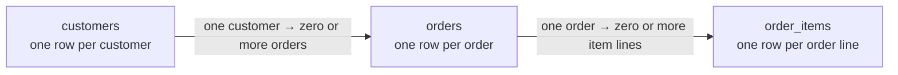

# Lab 01 — Relational SQL & Query Optimization

> **Your mission:** Turn customer orders into reliable business insights, and discover why two queries returning identical results can have very different execution costs.

**You will practice:** JOINs, aggregation, correlated subqueries, NULL handling, window functions and query plans.

**Environment:** PostgreSQL in GitHub Codespaces. No local Docker installation is required.

!!! info "Your work"

    **Edit:** In your Codespace Explorer, open `labs → 01-relational-sql → sql → student_answers.sql` and write your answers below the 15 questions. The GitHub link below is a reference; edit your own Codespace copy.

    **Run and check:** After starting the lab, run your saved SQL from the lab folder:

    ```bash
    cd labs/01-relational-sql
    docker compose exec -T postgres psql -v ON_ERROR_STOP=1 -U student -d query_lab < sql/student_answers.sql
    ```

    Read the output and compare it with each question's requirements. From the repository root, `make test LAB=01-relational-sql` checks sample data and services; it **does not grade your answers**.

    **Keep and submit:** Save your completed SQL, short explanations for questions 6, 7 and 15, and query plans for selected queries. Follow your instructor's submission instructions. [How to save a copy outside the Codespace](../start-lab01.md#4-write-and-save-your-answers).

## 1. Get ready

New to Codespaces? Follow the illustrated [first SQL lab walkthrough](../start-lab01.md).

Open the [course repository](https://github.com/OrPerets/postgres-data-engineering-student) in Codespaces. In the terminal, **from the repository root**, run:

```bash
make lab-sql
```

When the initializer finishes, open your student answer file in the Codespace Explorer as shown above. You can also [view the starter file on GitHub](https://github.com/OrPerets/postgres-data-engineering-student/blob/main/labs/01-relational-sql/sql/student_answers.sql); it contains all 15 questions with empty answer sections.

### Checkpoint — Can you access the data?

```bash
cd labs/01-relational-sql
docker compose exec postgres psql -U student -d query_lab
```

Inside PostgreSQL:

```sql
SELECT COUNT(*) FROM customers;
SELECT * FROM orders LIMIT 5;
```

Exit with `\q`.

**Expected:** SQL runs and returns records. If the service is unavailable, see [Troubleshooting](../troubleshooting.md).

## 2. Understand the data

You are analyzing three related tables:

| Table | What one row represents |
|---|---|
| `customers` | One customer |
| `orders` | One order, with date and status |
| `order_items` | One product line inside an order |

The lab uses **synthetic data** designed to expose common SQL mistakes.

### How the tables connect



Read the arrows from left to right: an order belongs to one customer, and each item line belongs to one order. A customer can have no orders, and the schema does not require an order to have an item line.

**Example:** If one customer has one order containing two item lines, joining that order to its item lines produces **two rows** for the order. The order count is still one. This is why the row's **grain**—what one row represents—matters before you count or average.

[Try the interactive JOIN explorer and practice quiz](../activities/lab01-learning-pack.md). Both use separate small teaching examples and run in your browser.

### Business rules

- Count only `completed` orders in revenue unless the question says otherwise.
- Exclude cancelled and returned orders from revenue; a returned order represents a full return.
- A `NULL` discount means no discount.
- Net revenue for one order line is:

```sql
quantity * unit_price * (1 - COALESCE(discount_pct, 0) / 100.0)
```

### Think before coding

**Question:** Does a completed order with a 100% discount count as a completed order? Does it contribute revenue?

Write your prediction, then test it with SQL.

## 3. Complete the 15 SQL questions

Open `labs/01-relational-sql/sql/student_answers.sql`. Write SQL beneath each numbered question.

Work in this sequence:

1. **Queries 1–5:** Filters, JOINs, grouping and business metrics.
2. **Queries 6–7:** Debugging aggregation and `NOT IN` / `NULL` behavior.
3. **Queries 8–11:** Ranking, previous values, running totals and monthly comparisons.
4. **Queries 12–15:** More advanced relational logic, product pairs and window-frame semantics.

### Checkpoint — Is the output actually correct?

Before moving on, ask:

- Does my JOIN accidentally multiply order counts?
- Do customers with no orders still appear when required?
- Does my calculation handle `NULL` correctly?
- Is my `ORDER BY` deterministic when dates or amounts tie?

**Hint:** When an order has several items, calculate *per-order* metrics at the order grain before joining them to per-customer summaries.

### Optional hints for questions 1–15

Try each question on your own first. Open a hint when you need a direction; these hints do not contain the assignment answers.

<details><summary>Question 1 — Dates and conditions</summary><p>Which conditions must the January date restriction apply to? Check how parentheses affect the order of AND and OR.</p></details>

<details><summary>Question 2 — Customer metrics</summary><p>Consider calculating revenue per order before summarizing per customer. How will you keep a customer with no completed orders, and distinguish zero revenue from an unknown average?</p></details>

<details><summary>Question 3 — Both categories, no returns</summary><p>Think about the customer's purchases across all completed orders, then separately test whether any returned order exists. The required categories need not appear in the same order.</p></details>

<details><summary>Question 4 — Compare with other orders</summary><p>First work at the order grain. When forming the comparison average, exclude the current order and consider what happens when there are no other completed orders.</p></details>

<details><summary>Question 5 — City summaries</summary><p>Build counts at the appropriate customer and order grains before combining them by city. Keep customers with no orders and consider a city with a zero-order denominator.</p></details>

<details><summary>Question 6 — Debug an aggregate</summary><p>Trace what the WHERE filter does to unmatched customers, what each joined row represents, and whether the average is over order lines or orders. Check the requested output and final thresholds separately.</p></details>

<details><summary>Question 7 — Missing cities and NOT IN</summary><p>What happens if the subquery produces a NULL city? Consider a way to test for the absence of a matching returned-order city while separately requiring the outer city to be known.</p></details>

<details><summary>Question 8 — Revenue ranks</summary><p>Compute each customer's revenue first. Compare what ROW_NUMBER, RANK and DENSE_RANK do with equal revenue; a tie-breaker used for row numbering should not break revenue ties in the other rankings.</p></details>

<details><summary>Question 9 — Order history</summary><p>Compute one revenue value per completed order, then consider windows partitioned by customer and ordered by date and order ID. Define the moving frame and protect percentage calculations when the previous value is absent or zero.</p></details>

<details><summary>Question 10 — Top category</summary><p>Summarize revenue at customer-and-category grain, then choose one category per customer with a deterministic tie-break. Compare that amount with the customer's total, including the zero-total case.</p></details>

<details><summary>Question 11 — Complete months</summary><p>Make sure each customer has a row for each of the three months before comparing adjacent months. Distinguish the first month from a previous month with zero revenue.</p></details>

<details><summary>Question 12 — Every sold category</summary><p>Derive the required category set from completed orders, and compare each customer's coverage with that set. A free purchase still counts; handle an empty required set explicitly.</p></details>

<details><summary>Question 13 — Product pairs</summary><p>Start with unique products per completed order, then form pairs in a consistent alphabetical order. What must you count so repeated lines in one order cannot inflate the result?</p></details>

<details><summary>Question 14 — First threshold crossing</summary><p>Build cumulative revenue in the specified order first. Only then determine which qualifying order is earliest for each customer.</p></details>

<details><summary>Question 15 — ROWS and RANGE</summary><p>Identify the ordering columns and frame for each cumulative calculation. Under a date-only ordering, consider whether same-day orders are peers and how that affects each result.</p></details>

## 4. Experiment — Why can a Window Function be faster?

**Goal:** Calculate each customer's running total without recomputing all previous transactions.

First predict which version will be faster: a correlated subquery or `SUM(...) OVER (...)`. Both should return the same answers.

Run the benchmark setup:

```bash
docker compose exec -T postgres psql -U student -d query_lab < benchmarks/01_seed_running_total.sql
```

Now run the **compact comparison**:

```bash
docker compose exec -T postgres psql -U student -d query_lab < benchmarks/03_compact_report.sql
```

You'll see:

- Number of sequential scan executions.
- Aggregate/Window and sort executions.
- Shared buffer hits.
- Total runtime for both approaches.
- Side-by-side sample outputs and a full-data `MATCH` / `MISMATCH` check.

### Understand the result

The correlated subquery may repeatedly scan the table for each transaction. The window plan can sort and process the ordered rows with incremental running aggregation.

**Important:** A Window Function is not always faster. This benchmark deliberately uses a case where repeated work is expensive. Indexes, table size and caching can change the result.

### Optional challenge

Read the [performance challenge](https://github.com/OrPerets/postgres-data-engineering-student/blob/main/labs/01-relational-sql/benchmarks/STUDENT_CHALLENGE.md). Add a composite index and compare again.

## 5. Reflect and finish

Before leaving the lab, be ready to explain:

1. Why a LEFT JOIN followed by a WHERE filter can accidentally remove customers without orders.
2. Why `ROWS` and `RANGE` may produce different cumulative results when dates tie.
3. Why your two running-total queries produce identical outputs but different execution plans.

## Job interview questions

Try answering aloud before expanding each suggested answer. Use examples from this lab to support your explanation.

<details><summary>1. How can a WHERE condition change the result of a LEFT JOIN?</summary><p>A LEFT JOIN keeps unmatched rows from the left table, with NULLs for the right side. A WHERE condition such as <code>o.status = 'completed'</code> removes those unmatched rows. Put a right-side filter in the JOIN condition when unmatched left rows must remain, and check the intended semantics.</p></details>

<details><summary>2. Why can NOT IN return no rows when the subquery contains NULL?</summary><p>Comparisons involving NULL can be unknown. If no equal value is found but the list contains NULL, <code>NOT IN</code> can evaluate to unknown and the WHERE clause excludes that row. Consider <code>NOT EXISTS</code>, while explicitly deciding how NULL values in the outer column should be handled.</p></details>

<details><summary>3. How does a window function differ from GROUP BY?</summary><p>GROUP BY produces one row per group; a window function calculates across related rows while retaining the individual input rows. For a customer running total, partition by customer and order by date plus a stable tie-breaker; choose the frame deliberately.</p></details>

<details><summary>4. How would you investigate a slow SQL query?</summary><p>First check that it returns the intended results, then examine <code>EXPLAIN (ANALYZE, BUFFERS)</code> for actual row counts, repeated work, scans, sorts and buffer activity. Compare alternatives under representative data and conditions; indexes and plans depend on the workload. ANALYZE executes the query, so take care with statements that modify data.</p></details>

<details><summary>5. What are the advantages of window functions, and when would you use them?</summary><p>They let you add group-level or ordered calculations to individual rows without collapsing them. Common uses include running totals, ranking customers and comparing each order with the previous one. They can make a query clearer than a self-join or correlated subquery, but speed depends on the plan and data; measure it.</p></details>

<details><summary>6. What do PARTITION BY, ORDER BY and a window frame control?</summary><p><code>PARTITION BY</code> defines groups, <code>ORDER BY</code> orders rows within each group, and the frame selects the rows used by frame-sensitive calculations such as a running sum. In PostgreSQL, an ordered window's default frame includes peers with equal ordering values; specify a frame and tie-breaker when you need a particular row-by-row result.</p></details>

<details><summary>7. How do ROW_NUMBER and RANK handle ties?</summary><p><code>ROW_NUMBER()</code> assigns a different number to every row; add a stable tie-breaker for reproducible selection. <code>RANK()</code> gives equal ranks to peers and leaves gaps after ties. If ties must share a rank, do not add a unique identifier to that ranking window's ordering.</p></details>

<details><summary>8. How can you filter to the three highest-ranked orders per customer?</summary><p>Compute <code>ROW_NUMBER()</code> in a subquery or CTE, partitioned by customer and ordered by the intended measure and a stable tie-breaker. Filter the resulting number in the outer query. Window results are computed after the same query level's <code>WHERE</code>, so they cannot be filtered there directly.</p></details>

**Deliverable:** Your completed `student_answers.sql`, together with any explanation or benchmark evidence requested by your instructor.

**Next:** [Lab 02 — Partitions & Replication](02-partitions-replicas.md).


## Visual checkpoint — One result, two query plans

The running-total benchmark computes identical per-row results using two approaches.

| Stage | Correlated subquery | Window function |
|---|---|---|
| Read sales | Outer scan, then repeated inner scans | One main scan |
| Order rows | No explicit sort in original plan | Sort by customer, date, sale ID |
| Calculate cumulative sum | Repeated aggregate per sale | One WindowAgg plan node |
| Verify | Compare every output row | Compare every output row |

### Five-row illustration (not a timing measurement)

| Sale ID | Amount | Running total |
|---|---:|---:|
| 1 | 10 | 10 |
| 2 | 20 | 30 |
| 3 | 30 | 60 |
| 4 | 40 | 100 |
| 5 | 50 | 150 |

**Predict:** How many previous values would the naive correlated approach revisit for the fifth row? How many new values does an incremental running sum need to add when moving from row four to row five?

**Try it:** Run `benchmarks/03_compact_report.sql` and compare the real execution counts. The five-row table is only an illustrative example; the benchmark itself uses a larger synthetic dataset.
