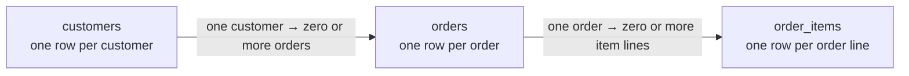

# Tutorial & practice — Lab 01

**Chapter 2 of 4 · PostgreSQL and customer orders**

Start the lab, learn what each row represents, and solve the 15 SQL questions. Need a refresher first? Visit [Window functions](01-window-functions.md). [← All Lab 01 chapters](01-relational-sql.md)

## 1 · Meet the data

The lab uses **synthetic data** for a small order system. Each table has its own grain: what one row represents.



| Table | Key columns | One row means |
|---|---|---|
| `customers` | `customer_id`, `full_name`, `city` | One customer. A city can be `NULL`. |
| `orders` | `order_id`, `customer_id`, `order_date`, `status` | One order. Its status is `completed`, `cancelled`, `returned`, or `pending`. |
| `order_items` | `order_id`, `line_no`, `product_name`, `category`, `quantity`, `unit_price`, `discount_pct` | One item line in an order. The key is `(order_id, line_no)`. |

A customer can have no orders; the schema also permits an order with no item lines. If an order has two lines, joining it to `order_items` produces two rows, but it is still **one order**. [Try the JOIN explorer](../activities/lab01-learning-pack.md#explore-joins).

<details markdown="1">
<summary>Business rules for the questions</summary>

- Use only `completed` orders for revenue unless a question says otherwise. A returned order represents a full return.
- A `NULL` discount means no discount. A completed order with a 100% discount still counts as an order, even though the discounted line contributes zero revenue.
- The net revenue of an item line is:

```sql
quantity * unit_price * (1 - COALESCE(discount_pct, 0) / 100.0)
```

A completed order without item lines has zero revenue when included in an order-level revenue calculation. The exercise schema is in `labs/01-relational-sql/sql/01_schema.sql`.
</details>

## 2 · Start the lab and create the sample data

Open the [student repository](https://github.com/OrPerets/postgres-data-engineering-student) in GitHub Codespaces. From the **repository root**, run:

```bash
make lab-sql
```

On a fresh lab, the initializer creates the classroom tables and loads the synthetic sample data. Existing tables are preserved; an incomplete setup is reported instead of being silently recreated. [Follow the illustrated setup walkthrough](../start-lab01.md) if this is your first Codespace.

<details markdown="1">
<summary>Check that PostgreSQL and the sample data are available</summary>

From a shell terminal, open PostgreSQL:

```bash
cd labs/01-relational-sql
docker compose exec postgres psql -U student -d query_lab
```

Then try these queries in `psql`:

```sql
SELECT COUNT(*) FROM customers;
SELECT * FROM orders LIMIT 5;
```

You should see records. Enter `\q` to exit. If the service does not start, see [Troubleshooting](../troubleshooting.md). The schema creation script itself drops and recreates the exercise tables; do not use it for routine startup.
</details>

## 3 · Choose where to write your answers

Both routes use the same lab database, but the drafts are **separate copies** and do not automatically synchronize.

<details markdown="1">
<summary>Route A · Guided workspace</summary>

From the repository root, run:

```bash
make lab-sql-workspace
```

Keep that terminal running and open private port **8765** from the Codespace **Ports** tab. Choose a question and write your SQL. **Run query** runs the current or selected statement as read-only SQL.

Select **Save answers** regularly; edits are not autosaved. Select **Download SQL** to keep the current draft outside the Codespace. The guided draft is stored in `.workspace-data/`, which Git ignores: committing the original worksheet does not back up this draft. [See how to open and save your work](../start-lab01.md#4-write-and-save-your-answers).
</details>

<details markdown="1">
<summary>Route B · Codespace editor and psql</summary>

Edit `labs/01-relational-sql/sql/student_answers.sql` in the Explorer and save it with **Ctrl+S** (Windows/Linux) or **⌘S** (Mac). From the lab folder run:

```bash
cd labs/01-relational-sql
docker compose exec -T postgres psql -v ON_ERROR_STOP=1 -U student -d query_lab < sql/student_answers.sql
```

Download the saved worksheet from Explorer or commit and push it to your own fork to keep a copy outside the Codespace. The [starter worksheet on GitHub](https://github.com/OrPerets/postgres-data-engineering-student/blob/main/labs/01-relational-sql/sql/student_answers.sql) contains all 15 complete question descriptions and blank answer sections.
</details>

**Check and submit:** `make test LAB=01-relational-sql` from the repository root checks the sample data and services; it does **not** grade your SQL. Keep your completed answers, short explanations for questions 6, 7 and 15, and any requested plans or worksheet work. Download separate explanations and plans as needed. Saving or downloading is not submission: follow your instructor's method and deadline.

## 4 · Work through the 15 questions

Use the question descriptions in your workspace or the [SQL worksheet](https://github.com/OrPerets/postgres-data-engineering-student/blob/main/labs/01-relational-sql/sql/student_answers.sql). Try each query yourself before opening a hint.

| Questions | Focus | Helpful preparation |
|---|---|---|
| 1–5 | Filters, joins, grouping and business metrics | Trace the grain of each join. |
| 6–7 | Debug aggregation and `NOT IN` / `NULL` | [Explore NULL comparisons](../activities/lab01-learning-pack.md#explore-not-in-and-null). |
| 8–11 | Rankings, previous orders, running totals and months | [Explore window functions](01-window-functions.md). Its SQL worksheet is separate from the guided draft. |
| 12–15 | Relational logic, product pairs and window frames | Check ties, order and frame choices. |

<details markdown="1">
<summary>See the question roadmap</summary>

These are short prompts; use the worksheet for the full conditions and supplied queries.

1. Select January orders that match the stated customer and status conditions.
2. Calculate completed-order metrics for every customer, including those with no completed orders.
3. Find customers who bought in both specified categories and have no returned orders.
4. Compare each completed order's revenue with the customer's other completed orders.
5. Summarize order statuses and completion percentages by city.
6. Diagnose and correct the supplied aggregate query, then apply the requested thresholds.
7. Explain and correct the supplied `NOT IN` query when a city is `NULL`.
8. Rank customer revenue within each city and return the top two distinct revenue levels, including ties.
9. Calculate previous-order revenue, change, cumulative revenue and a moving average for each completed order.
10. Find each customer's highest-revenue category and its share of their total.
11. Compare monthly revenues across January–March, including months without purchases.
12. Find customers who purchased from every category sold in completed orders, using two solutions.
13. Count product pairs purchased together in at least two completed orders.
14. Find the first order where each qualifying customer's cumulative revenue reaches 500.
15. Compare `ROWS` and `RANGE` cumulative sums for the same-day orders.
</details>

**Checkpoint:** Does your join multiply order counts? Are customers without orders kept where required? Are `NULL` values handled? Is the order deterministic when dates or amounts tie?

<details markdown="1">
<summary>Optional hints for questions 1–15</summary>

Try each question on your own first. Open a hint when you need a direction; these hints do not contain the assignment answers.

<details><summary>Question 1 — Dates and conditions</summary><p>Which conditions must the January date restriction apply to? Check how parentheses affect the order of AND and OR.</p></details>

<details><summary>Question 2 — Customer metrics</summary><p>Consider calculating revenue per order before summarizing per customer. How will you keep a customer with no completed orders, and distinguish zero revenue from an unknown average?</p></details>

<details><summary>Question 3 — Both categories, no returns</summary><p>Think about the customer's purchases across all completed orders, then separately test whether any returned order exists. The required categories need not appear in the same order.</p></details>

<details><summary>Question 4 — Compare with other orders</summary><p>First work at the order grain. When forming the comparison average, exclude the current order and consider what happens when there are no other completed orders.</p></details>

<details><summary>Question 5 — City summaries</summary><p>Build counts at the appropriate customer and order grains before combining them by city. Keep customers with no orders and consider a city with a zero-order denominator.</p></details>

<details><summary>Question 6 — Debug an aggregate</summary><p>Trace what the WHERE filter does to unmatched customers, what each joined row represents, and whether the average is over order lines or orders. Check the requested output and final thresholds separately.</p></details>

<details><summary>Question 7 — Missing cities and NOT IN</summary><p>What happens if the subquery produces a NULL city? Consider a way to test for the absence of a matching returned-order city while separately requiring the outer city to be known.</p></details>

<details><summary>Question 8 — Revenue ranks</summary><p>Compute each customer's revenue first. Compare what ROW_NUMBER, RANK and DENSE_RANK do with equal revenue; a tie-breaker used for row numbering should not break revenue ties in the other rankings.</p></details>

<details><summary>Question 9 — Order history</summary><p>Compute one revenue value per completed order, then consider windows partitioned by customer and ordered by date and order ID. Define the moving frame and protect percentage calculations when the previous value is absent or zero.</p></details>

<details><summary>Question 10 — Top category</summary><p>Summarize revenue at customer-and-category grain, then choose one category per customer with a deterministic tie-break. Compare that amount with the customer's total, including the zero-total case.</p></details>

<details><summary>Question 11 — Complete months</summary><p>Make sure each customer has a row for each of the three months before comparing adjacent months. Distinguish the first month from a previous month with zero revenue.</p></details>

<details><summary>Question 12 — Every sold category</summary><p>Derive the required category set from completed orders, and compare each customer's coverage with that set. A free purchase still counts; handle an empty required set explicitly.</p></details>

<details><summary>Question 13 — Product pairs</summary><p>Start with unique products per completed order, then form pairs in a consistent alphabetical order. What must you count so repeated lines in one order cannot inflate the result?</p></details>

<details><summary>Question 14 — First threshold crossing</summary><p>Build cumulative revenue in the specified order first. Only then determine which qualifying order is earliest for each customer.</p></details>

<details><summary>Question 15 — ROWS and RANGE</summary><p>Identify the ordering columns and frame for each cumulative calculation. Under a date-only ordering, consider whether same-day orders are peers and how that affects each result.</p></details>

</details>


## 5 · Optional performance experiment

**Goal:** Calculate each customer's running total without recomputing all previous transactions.

First predict which version will be faster: a correlated subquery or `SUM(...) OVER (...)`. Both should return the same answers.

<details markdown="1">
<summary>Run the benchmark and inspect the plans</summary>

**Before running setup:** The seed drops and recreates `benchmark_sales`, deleting its existing rows and indexes, including any index you added for the challenge. It does not drop the `customers`, `orders`, or `order_items` classroom tables. If you want to keep an earlier benchmark experiment, back up the table's data and schema (including index definitions) outside the Codespace before reseeding, or keep the existing table and skip the seed. Save any query plans or timing results separately.

From a **shell terminal** at the repository root, enter the lab folder. If you are already in `labs/01-relational-sql`, skip the `cd` command. Run setup only when you are ready to replace the benchmark table:

```bash
cd labs/01-relational-sql
docker compose exec -T postgres psql -U student -d query_lab < benchmarks/01_seed_running_total.sql
```

From the same lab folder, run the **compact comparison**:

```bash
docker compose exec -T postgres psql -U student -d query_lab < benchmarks/03_compact_report.sql
```

You'll see:

- Number of sequential scan executions.
- Aggregate/Window and sort executions.
- Shared buffer hits.
- Total runtime for both approaches.
- Side-by-side sample outputs and a full-data `MATCH` / `MISMATCH` check.

**Understand the result**

The correlated subquery may repeatedly scan the table for each transaction. The window plan can sort and process the ordered rows with incremental running aggregation.

**Important:** A Window Function is not always faster. This benchmark deliberately uses a case where repeated work is expensive. Indexes, table size and caching can change the result.

**Optional challenge**

Read the [performance challenge](https://github.com/OrPerets/postgres-data-engineering-student/blob/main/labs/01-relational-sql/benchmarks/STUDENT_CHALLENGE.md). Add a composite index and compare again.

**Visual checkpoint — One result, two query plans**

The running-total benchmark computes identical per-row results using two approaches.

| Stage | Correlated subquery | Window function |
|---|---|---|
| Read sales | Outer scan, then repeated inner scans | One main scan |
| Order rows | No explicit sort in original plan | Sort by customer, date, sale ID |
| Calculate cumulative sum | Repeated aggregate per sale | One WindowAgg plan node |
| Verify | Compare every output row | Compare every output row |

**Five-row illustration (not a timing measurement)**

| Sale ID | Amount | Running total |
|---|---:|---:|
| 1 | 10 | 10 |
| 2 | 20 | 30 |
| 3 | 30 | 60 |
| 4 | 40 | 100 |
| 5 | 50 | 150 |

**Predict:** How many previous values would the naive correlated approach revisit for the fifth row? How many new values does an incremental running sum need to add when moving from row four to row five?

**Try it:** Run `benchmarks/03_compact_report.sql` and compare the real execution counts. The five-row table is only an illustrative example; the benchmark itself uses a larger synthetic dataset.

</details>


## Finish

Keep your SQL and the evidence requested by your instructor. Next, practice explaining your choices in the [job interview questions](01-interview.md), or check your understanding in [Test yourself](01-test-yourself.md).
