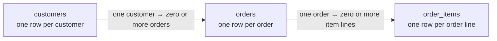

# Tutorial & practice — Lab 01

**Chapter 2 of 4 · PostgreSQL and customer orders**

Learn what each row represents, then solve the 15 SQL questions in your browser. No Codespace setup is needed for browser practice. Need a refresher first? Visit [Window functions](01-window-functions.md). [← All Lab 01 chapters](01-relational-sql.md)

[Jump to the 15 questions and SQL editors ↓](#lab01-practice)

## 1 · Meet the data

The lab uses **synthetic data** for a small order system. Each table has its own grain: what one row represents.



| Table | Key columns | One row means |
|---|---|---|
| `customers` | `customer_id`, `full_name`, `city` | One customer. A city can be `NULL`. |
| `orders` | `order_id`, `customer_id`, `order_date`, `status` | One order. Its status is `completed`, `cancelled`, `returned`, or `pending`. |
| `order_items` | `order_id`, `line_no`, `product_name`, `category`, `quantity`, `unit_price`, `discount_pct` | One item line in an order. The key is `(order_id, line_no)`. |

A customer can have no orders; the schema also permits an order with no item lines. If an order has two lines, joining it to `order_items` produces two rows, but it is still **one order**. [Try the JOIN explorer](../activities/lab01-learning-pack.md#explore-joins).

<details markdown="1">
<summary>Business rules for the questions</summary>

- Use only `completed` orders for revenue unless a question says otherwise. A returned order represents a full return.
- A `NULL` discount means no discount. A completed order with a 100% discount still counts as an order, even though the discounted line contributes zero revenue.
- The net revenue of an item line is:

```sql
quantity * unit_price * (1 - COALESCE(discount_pct, 0) / 100.0)
```

A completed order without item lines has zero revenue when included in an order-level revenue calculation. The exercise schema is in `labs/01-relational-sql/sql/01_schema.sql`.
</details>

## 2 · Optional: start the lab in a Codespace

The browser editors below have their own copy of the sample data. Follow this section only if you also want to work with the lab database in a Codespace.

Open the [student repository](https://github.com/OrPerets/postgres-data-engineering-student) in GitHub Codespaces. From the **repository root**, run:

```bash
make lab-sql
```

On a fresh lab, the initializer creates the classroom tables and loads the synthetic sample data. Existing tables are preserved; an incomplete setup is reported instead of being silently recreated. [Follow the illustrated setup walkthrough](../start-lab01.md) if this is your first Codespace.

<details markdown="1">
<summary>Check that PostgreSQL and the sample data are available</summary>

From a shell terminal, open PostgreSQL:

```bash
cd labs/01-relational-sql
docker compose exec postgres psql -U student -d query_lab
```

Then try these queries in `psql`:

```sql
SELECT COUNT(*) FROM customers;
SELECT * FROM orders LIMIT 5;
```

You should see records. Enter `\q` to exit. If the service does not start, see [Troubleshooting](../troubleshooting.md). The schema creation script itself drops and recreates the exercise tables; do not use it for routine startup.
</details>

## 3 · Optional: write answers in a Codespace

Both routes use the same lab database, but the drafts are **separate copies** and do not automatically synchronize.

<details markdown="1">
<summary>Route A · Guided workspace</summary>

From the repository root, run:

```bash
make lab-sql-workspace
```

Keep that terminal running and open private port **8765** from the Codespace **Ports** tab. Choose a question and write your SQL. **Run query** runs the current or selected statement as read-only SQL.

Select **Save answers** regularly; edits are not autosaved. Select **Download SQL** to keep the current draft outside the Codespace. The guided draft is stored in `.workspace-data/`, which Git ignores: committing the original worksheet does not back up this draft. [See how to open and save your work](../start-lab01.md#4-write-and-save-your-answers).
</details>

<details markdown="1">
<summary>Route B · Codespace editor and psql</summary>

Edit `labs/01-relational-sql/sql/student_answers.sql` in the Explorer and save it with **Ctrl+S** (Windows/Linux) or **⌘S** (Mac). From the lab folder run:

```bash
cd labs/01-relational-sql
docker compose exec -T postgres psql -v ON_ERROR_STOP=1 -U student -d query_lab < sql/student_answers.sql
```

Download the saved worksheet from Explorer or commit and push it to your own fork to keep a copy outside the Codespace. The [starter worksheet on GitHub](https://github.com/OrPerets/postgres-data-engineering-student/blob/main/labs/01-relational-sql/sql/student_answers.sql) contains all 15 complete question descriptions and blank answer sections.
</details>

**Check and submit:** If you use a Codespace, `make test LAB=01-relational-sql` from the repository root checks the sample data and services; it does **not** grade your SQL. Whether you use the browser or Codespace, keep your completed answers, short explanations for questions 6, 7 and 15, and any requested plans or worksheet work. Download your browser answers and keep separate explanations or plans as needed. Saving or downloading is not submission: follow your instructor's method and deadline.

## 4 · Work through the 15 questions

Write and run your own SQL for each question below. Try each question yourself before opening a hint.

| Questions | Focus | Helpful preparation |
|---|---|---|
| 1–5 | Filters, joins, grouping and business metrics | Trace the grain of each join. |
| 6–7 | Debug aggregation and `NOT IN` / `NULL` | [Explore NULL comparisons](../activities/lab01-learning-pack.md#explore-not-in-and-null). |
| 8–11 | Rankings, previous orders, running totals and months | [Explore window functions](01-window-functions.md). Its SQL worksheet is separate from the guided draft. |
| 12–15 | Relational logic, product pairs and window frames | Check ties, order and frame choices. |

<details markdown="1">
<summary>See the question roadmap</summary>

These are short prompts; use the worksheet for the full conditions and supplied queries.

1. Select January orders that match the stated customer and status conditions.
2. Calculate completed-order metrics for every customer, including those with no completed orders.
3. Find customers who bought in both specified categories and have no returned orders.
4. Compare each completed order's revenue with the customer's other completed orders.
5. Summarize order statuses and completion percentages by city.
6. Diagnose and correct the supplied aggregate query, then apply the requested thresholds.
7. Explain and correct the supplied `NOT IN` query when a city is `NULL`.
8. Rank customer revenue within each city and return the top two distinct revenue levels, including ties.
9. Calculate previous-order revenue, change, cumulative revenue and a moving average for each completed order.
10. Find each customer's highest-revenue category and its share of their total.
11. Compare monthly revenues across January–March, including months without purchases.
12. Find customers who purchased from every category sold in completed orders, using two solutions.
13. Count product pairs purchased together in at least two completed orders.
14. Find the first order where each qualifying customer's cumulative revenue reaches 500.
15. Compare `ROWS` and `RANGE` cumulative sums for the same-day orders.
</details>

<div class="lab01-practice" id="lab01-practice" data-lab01-practice markdown="1">

### Your SQL practice

Run read-only PostgreSQL queries directly in this browser using a separate copy of the sample data. The first run may take a moment to load; results show up to 100 rows. The browser database starts fresh when you reload the page or a query is interrupted; it is separate from your Codespace database.

<noscript>Enable JavaScript to run queries here. You can also use the optional Codespace routes above.</noscript>

Your SQL drafts are saved in this browser on this device. They do not sync with the guided workspace or worksheet. Download your answers to keep a backup or submit them as instructed. To run only part of an answer, select that SQL before choosing **Run query**.

<div class="lab01-practice-actions"><button type="button" data-practice-export>Download answers</button></div>

<div class="lab01-practice-layout" markdown="1">

<aside class="lab01-reference" aria-labelledby="lab01-reference-title"><h3 id="lab01-reference-title">Tables &amp; schema</h3><p>One customer → many orders → many item lines. Expand a table to see its columns, sample rows, or the full table.</p><p class="lab01-reference-legend"><strong>PK</strong> primary key · <strong>FK</strong> foreign key · <strong>Required</strong> cannot be NULL</p><details data-reference-table="customers"><summary><code>customers</code> <span>one row per customer</span></summary><ul><li><code>customer_id</code> <span>integer · PK · required</span></li><li><code>full_name</code> <span>varchar(120) · required</span></li><li><code>city</code> <span>varchar(80) · nullable</span></li></ul><div class="lab01-reference-actions"><button type="button" data-sample="customers">Sample rows</button><button type="button" data-view-all="customers">View all rows</button></div><p data-reference-status role="status" aria-live="polite"></p><div class="lab01-reference-result" data-reference-result></div></details><details data-reference-table="orders"><summary><code>orders</code> <span>one row per order</span></summary><ul><li><code>order_id</code> <span>integer · PK · required</span></li><li><code>customer_id</code> <span>integer · FK → customers.customer_id · required</span></li><li><code>order_date</code> <span>date · required</span></li><li><code>status</code> <span>varchar(20) · required</span></li></ul><div class="lab01-reference-actions"><button type="button" data-sample="orders">Sample rows</button><button type="button" data-view-all="orders">View all rows</button></div><p data-reference-status role="status" aria-live="polite"></p><div class="lab01-reference-result" data-reference-result></div></details><details data-reference-table="order_items"><summary><code>order_items</code> <span>one row per item line</span></summary><ul><li><code>order_id</code> <span>integer · PK, FK → orders.order_id · required</span></li><li><code>line_no</code> <span>integer · PK · required</span></li><li><code>product_name</code> <span>text · required</span></li><li><code>category</code> <span>text · required</span></li><li><code>quantity</code> <span>integer · required</span></li><li><code>unit_price</code> <span>numeric(12,2) · required</span></li><li><code>discount_pct</code> <span>numeric(5,2) · nullable</span></li></ul><p>The primary key is the pair <code>(order_id, line_no)</code>.</p><div class="lab01-reference-actions"><button type="button" data-sample="order_items">Sample rows</button><button type="button" data-view-all="order_items">View all rows</button></div><p data-reference-status role="status" aria-live="polite"></p><div class="lab01-reference-result" data-reference-result></div></details><noscript>Enable JavaScript to load sample rows; the schema above remains available.</noscript></aside>

<div class="lab01-practice-questions" markdown="1">

<section class="lab01-question" data-question="1" markdown="1">

### Question 01

Display up to five orders from January 2026 that satisfy either condition: the order was completed and the customer is from Haifa, or the order was cancelled. The January date restriction applies to both cases.

<details><summary>Question 1 — Dates and conditions</summary><p>Which conditions must the January date restriction apply to? Check how parentheses affect the order of AND and OR.</p></details>

<div class="lab01-editor">
<label for="lab01-sql-1">Your SQL for question 1</label>
<textarea id="lab01-sql-1" data-sql rows="6" spellcheck="false" placeholder="Write your SQL here"></textarea>
<div class="lab01-editor-actions"><button type="button" data-run>Run query</button></div>
<p class="lab01-status" data-status role="status" aria-live="polite"></p>
<div class="lab01-result" data-result></div>
</div>

</section>

<section class="lab01-question" data-question="2" markdown="1">

### Question 02

For every customer, display the number of completed orders, total revenue, average revenue per completed order, and date of the most recent completed order. Include customers with no completed orders, showing zero for the count and revenue and NULL for the average and date. Completed orders with zero revenue still count.

<details><summary>Question 2 — Customer metrics</summary><p>Consider calculating revenue per order before summarizing per customer. How will you keep a customer with no completed orders, and distinguish zero revenue from an unknown average?</p></details>

<div class="lab01-editor">
<label for="lab01-sql-2">Your SQL for question 2</label>
<textarea id="lab01-sql-2" data-sql rows="6" spellcheck="false" placeholder="Write your SQL here"></textarea>
<div class="lab01-editor-actions"><button type="button" data-run>Run query</button></div>
<p class="lab01-status" data-status role="status" aria-live="polite"></p>
<div class="lab01-result" data-result></div>
</div>

</section>

<section class="lab01-question" data-question="3" markdown="1">

### Question 03

Find customers who purchased from both the books and electronics categories in completed orders and have no returned orders anywhere in the dataset. The categories may occur in the same order or in different orders.

<details><summary>Question 3 — Both categories, no returns</summary><p>Think about the customer's purchases across all completed orders, then separately test whether any returned order exists. The required categories need not appear in the same order.</p></details>

<div class="lab01-editor">
<label for="lab01-sql-3">Your SQL for question 3</label>
<textarea id="lab01-sql-3" data-sql rows="6" spellcheck="false" placeholder="Write your SQL here"></textarea>
<div class="lab01-editor-actions"><button type="button" data-run>Run query</button></div>
<p class="lab01-status" data-status role="status" aria-live="polite"></p>
<div class="lab01-result" data-result></div>
</div>

</section>

<section class="lab01-question" data-question="4" markdown="1">

### Question 04

For every completed order, calculate its revenue and the average revenue of the other completed orders belonging to the same customer. Return only orders whose revenue is strictly greater than that average. Exclude customers with only one completed order.

<details><summary>Question 4 — Compare with other orders</summary><p>First work at the order grain. When forming the comparison average, exclude the current order and consider what happens when there are no other completed orders.</p></details>

<div class="lab01-editor">
<label for="lab01-sql-4">Your SQL for question 4</label>
<textarea id="lab01-sql-4" data-sql rows="6" spellcheck="false" placeholder="Write your SQL here"></textarea>
<div class="lab01-editor-actions"><button type="button" data-run>Run query</button></div>
<p class="lab01-status" data-status role="status" aria-live="polite"></p>
<div class="lab01-result" data-result></div>
</div>

</section>

<section class="lab01-question" data-question="5" markdown="1">

### Question 05

For each city, display the number of customers, total number of orders, number of orders in each status, and percentage of orders that were completed. Include customers with no orders. Display missing cities as Unknown and return NULL for the percentage when a city has no orders.

<details><summary>Question 5 — City summaries</summary><p>Build counts at the appropriate customer and order grains before combining them by city. Keep customers with no orders and consider a city with a zero-order denominator.</p></details>

<div class="lab01-editor">
<label for="lab01-sql-5">Your SQL for question 5</label>
<textarea id="lab01-sql-5" data-sql rows="6" spellcheck="false" placeholder="Write your SQL here"></textarea>
<div class="lab01-editor-actions"><button type="button" data-run>Run query</button></div>
<p class="lab01-status" data-status role="status" aria-live="polite"></p>
<div class="lab01-result" data-result></div>
</div>

</section>

<section class="lab01-question" data-question="6" markdown="1">

### Question 06

The following query is intended to count completed orders and calculate average revenue per completed order for every customer, including customers with no activity. Identify three logical errors and correct them. Then return only customers with at least two completed orders and total revenue of at least 500.

Query supplied in the assignment (to diagnose and correct):

```sql
SELECT c.customer_id, COUNT(*) AS completed_orders,
AVG(i.quantity * i.unit_price * (1 - COALESCE(i.discount_pct, 0) / 100.0)) AS avg_order_revenue
FROM customers c LEFT JOIN orders o ON o.customer_id = c.customer_id
LEFT JOIN order_items i ON i.order_id = o.order_id
WHERE o.status = 'completed'
GROUP BY c.customer_id;
```

<details><summary>Question 6 — Debug an aggregate</summary><p>Trace what the WHERE filter does to unmatched customers, what each joined row represents, and whether the average is over order lines or orders. Check the requested output and final thresholds separately.</p></details>

You can include your written explanation as SQL comments, using `--`.

<div class="lab01-editor">
<label for="lab01-sql-6">Your SQL for question 6</label>
<textarea id="lab01-sql-6" data-sql rows="6" spellcheck="false" placeholder="Write your SQL here"></textarea>
<div class="lab01-editor-actions"><button type="button" data-run>Run query</button></div>
<p class="lab01-status" data-status role="status" aria-live="polite"></p>
<div class="lab01-result" data-result></div>
</div>

</section>

<section class="lab01-question" data-question="7" markdown="1">

### Question 07

Find customers whose city is known and whose city has no customer with a returned order. Customers without orders may qualify. Predict the result of the following query on the supplied data, explain its behavior, and correct it.

Query supplied in the assignment (to diagnose and correct):

```sql
SELECT customer_id, full_name, city
FROM customers
WHERE city NOT IN (
SELECT c.city
FROM customers c
JOIN orders o ON o.customer_id = c.customer_id
WHERE o.status = 'returned'
);
```

<details><summary>Question 7 — Missing cities and NOT IN</summary><p>What happens if the subquery produces a NULL city? Consider a way to test for the absence of a matching returned-order city while separately requiring the outer city to be known.</p></details>

You can include your written explanation as SQL comments, using `--`.

<div class="lab01-editor">
<label for="lab01-sql-7">Your SQL for question 7</label>
<textarea id="lab01-sql-7" data-sql rows="6" spellcheck="false" placeholder="Write your SQL here"></textarea>
<div class="lab01-editor-actions"><button type="button" data-run>Run query</button></div>
<p class="lab01-status" data-status role="status" aria-live="polite"></p>
<div class="lab01-result" data-result></div>
</div>

</section>

<section class="lab01-question" data-question="8" markdown="1">

### Question 08

Calculate total revenue for each customer with at least one completed order. Within each city, return all customers at the two highest distinct revenue levels, including ties. Display ROW_NUMBER, RANK, and DENSE_RANK. Break ties in ROW_NUMBER by ascending customer_id, while preserving revenue ties in the other rankings.

<details><summary>Question 8 — Revenue ranks</summary><p>Compute each customer's revenue first. Compare what ROW_NUMBER, RANK and DENSE_RANK do with equal revenue; a tie-breaker used for row numbering should not break revenue ties in the other rankings.</p></details>

<div class="lab01-editor">
<label for="lab01-sql-8">Your SQL for question 8</label>
<textarea id="lab01-sql-8" data-sql rows="6" spellcheck="false" placeholder="Write your SQL here"></textarea>
<div class="lab01-editor-actions"><button type="button" data-run>Run query</button></div>
<p class="lab01-status" data-status role="status" aria-live="polite"></p>
<div class="lab01-result" data-result></div>
</div>

</section>

<section class="lab01-question" data-question="9" markdown="1">

### Question 09

For every completed order, display its revenue, the previous completed order’s revenue, the percentage change, cumulative revenue, and a moving average over up to the three most recent completed orders, including the current order. Calculate these separately for each customer, ordered by date and then order ID. Return NULL for percentage change when there is no previous order or its revenue is zero.

<details><summary>Question 9 — Order history</summary><p>Compute one revenue value per completed order, then consider windows partitioned by customer and ordered by date and order ID. Define the moving frame and protect percentage calculations when the previous value is absent or zero.</p></details>

<div class="lab01-editor">
<label for="lab01-sql-9">Your SQL for question 9</label>
<textarea id="lab01-sql-9" data-sql rows="6" spellcheck="false" placeholder="Write your SQL here"></textarea>
<div class="lab01-editor-actions"><button type="button" data-run>Run query</button></div>
<p class="lab01-status" data-status role="status" aria-live="polite"></p>
<div class="lab01-result" data-result></div>
</div>

</section>

<section class="lab01-question" data-question="10" markdown="1">

### Question 10

For each customer with a completed order, identify the category in which they spent the most. Break ties alphabetically by category name. Display the category’s revenue and its percentage of the customer’s total revenue. Return NULL for the percentage when total revenue is zero.

<details><summary>Question 10 — Top category</summary><p>Summarize revenue at customer-and-category grain, then choose one category per customer with a deterministic tie-break. Compare that amount with the customer's total, including the zero-total case.</p></details>

<div class="lab01-editor">
<label for="lab01-sql-10">Your SQL for question 10</label>
<textarea id="lab01-sql-10" data-sql rows="6" spellcheck="false" placeholder="Write your SQL here"></textarea>
<div class="lab01-editor-actions"><button type="button" data-run>Run query</button></div>
<p class="lab01-status" data-status role="status" aria-live="polite"></p>
<div class="lab01-result" data-result></div>
</div>

</section>

<section class="lab01-question" data-question="11" markdown="1">

### Question 11

Produce exactly three rows for every customer, covering January, February, and March 2026. Display monthly revenue, the previous month’s revenue, and the percentage change. Show zero revenue for months without purchases. For January, return NULL for the previous month’s revenue and percentage change. Also return NULL for percentage change when the previous month’s revenue is zero.

<details><summary>Question 11 — Complete months</summary><p>Make sure each customer has a row for each of the three months before comparing adjacent months. Distinguish the first month from a previous month with zero revenue.</p></details>

<div class="lab01-editor">
<label for="lab01-sql-11">Your SQL for question 11</label>
<textarea id="lab01-sql-11" data-sql rows="6" spellcheck="false" placeholder="Write your SQL here"></textarea>
<div class="lab01-editor-actions"><button type="button" data-run>Run query</button></div>
<p class="lab01-status" data-status role="status" aria-live="polite"></p>
<div class="lab01-result" data-result></div>
</div>

</section>

<section class="lab01-question" data-question="12" markdown="1">

### Question 12

Find customers who purchased from every category sold in a completed order anywhere in the dataset. Determine the required categories from the data. Purchases with a 100 percent discount still count. If no category has been sold, return an empty result. Provide two different solutions.

<details><summary>Question 12 — Every sold category</summary><p>Derive the required category set from completed orders, and compare each customer's coverage with that set. A free purchase still counts; handle an empty required set explicitly.</p></details>

<div class="lab01-editor">
<label for="lab01-sql-12">Your SQL for question 12</label>
<textarea id="lab01-sql-12" data-sql rows="6" spellcheck="false" placeholder="Write your SQL here"></textarea>
<div class="lab01-editor-actions"><button type="button" data-run>Run query</button></div>
<p class="lab01-status" data-status role="status" aria-live="polite"></p>
<div class="lab01-result" data-result></div>
</div>

</section>

<section class="lab01-question" data-question="13" markdown="1">

### Question 13

Find pairs of different products purchased together in at least two completed orders. Count each order once per pair, even when a product appears on multiple lines. Display each pair once, with the alphabetically smaller product name first, together with the number of orders containing the pair.

<details><summary>Question 13 — Product pairs</summary><p>Start with unique products per completed order, then form pairs in a consistent alphabetical order. What must you count so repeated lines in one order cannot inflate the result?</p></details>

<div class="lab01-editor">
<label for="lab01-sql-13">Your SQL for question 13</label>
<textarea id="lab01-sql-13" data-sql rows="6" spellcheck="false" placeholder="Write your SQL here"></textarea>
<div class="lab01-editor-actions"><button type="button" data-run>Run query</button></div>
<p class="lab01-status" data-status role="status" aria-live="polite"></p>
<div class="lab01-result" data-result></div>
</div>

</section>

<section class="lab01-question" data-question="14" markdown="1">

### Question 14

For each customer whose cumulative revenue from completed orders reached at least 500, return the first order at which they reached or exceeded that threshold. Determine the sequence by order date and then order ID. Include the cumulative revenue at that point and exclude customers who never reached the threshold.

<details><summary>Question 14 — First threshold crossing</summary><p>Build cumulative revenue in the specified order first. Only then determine which qualifying order is earliest for each customer.</p></details>

<div class="lab01-editor">
<label for="lab01-sql-14">Your SQL for question 14</label>
<textarea id="lab01-sql-14" data-sql rows="6" spellcheck="false" placeholder="Write your SQL here"></textarea>
<div class="lab01-editor-actions"><button type="button" data-run>Run query</button></div>
<p class="lab01-status" data-status role="status" aria-live="polite"></p>
<div class="lab01-result" data-result></div>
</div>

</section>

<section class="lab01-question" data-question="15" markdown="1">

### Question 15

For customer 1, calculate completed-order revenue and two cumulative sums. The first uses ORDER BY order_date, order_id with a ROWS frame from the beginning through the current row. The second uses ORDER BY order_date with a RANGE frame from the beginning through the current row. Predict both cumulative values for each order dated 2026-02-05 and explain the difference.

<details><summary>Question 15 — ROWS and RANGE</summary><p>Identify the ordering columns and frame for each cumulative calculation. Under a date-only ordering, consider whether same-day orders are peers and how that affects each result.</p></details>

You can include your written explanation as SQL comments, using `--`.

<div class="lab01-editor">
<label for="lab01-sql-15">Your SQL for question 15</label>
<textarea id="lab01-sql-15" data-sql rows="6" spellcheck="false" placeholder="Write your SQL here"></textarea>
<div class="lab01-editor-actions"><button type="button" data-run>Run query</button></div>
<p class="lab01-status" data-status role="status" aria-live="polite"></p>
<div class="lab01-result" data-result></div>
</div>

</section>

</div>

</div>

</div>

**Checkpoint:** Does your join multiply order counts? Are customers without orders kept where required? Are `NULL` values handled? Is the order deterministic when dates or amounts tie?

## 5 · Optional performance experiment

**Goal:** Calculate each customer's running total without recomputing all previous transactions.

First predict which version will be faster: a correlated subquery or `SUM(...) OVER (...)`. Both should return the same answers.

<details markdown="1">
<summary>Run the benchmark and inspect the plans</summary>

**Before running setup:** The seed drops and recreates `benchmark_sales`, deleting its existing rows and indexes, including any index you added for the challenge. It does not drop the `customers`, `orders`, or `order_items` classroom tables. If you want to keep an earlier benchmark experiment, back up the table's data and schema (including index definitions) outside the Codespace before reseeding, or keep the existing table and skip the seed. Save any query plans or timing results separately.

From a **shell terminal** at the repository root, enter the lab folder. If you are already in `labs/01-relational-sql`, skip the `cd` command. Run setup only when you are ready to replace the benchmark table:

```bash
cd labs/01-relational-sql
docker compose exec -T postgres psql -U student -d query_lab < benchmarks/01_seed_running_total.sql
```

From the same lab folder, run the **compact comparison**:

```bash
docker compose exec -T postgres psql -U student -d query_lab < benchmarks/03_compact_report.sql
```

You'll see:

- Number of sequential scan executions.
- Aggregate/Window and sort executions.
- Shared buffer hits.
- Total runtime for both approaches.
- Side-by-side sample outputs and a full-data `MATCH` / `MISMATCH` check.

**Understand the result**

The correlated subquery may repeatedly scan the table for each transaction. The window plan can sort and process the ordered rows with incremental running aggregation.

**Important:** A Window Function is not always faster. This benchmark deliberately uses a case where repeated work is expensive. Indexes, table size and caching can change the result.

**Optional challenge**

Read the [performance challenge](https://github.com/OrPerets/postgres-data-engineering-student/blob/main/labs/01-relational-sql/benchmarks/STUDENT_CHALLENGE.md). Add a composite index and compare again.

**Visual checkpoint — One result, two query plans**

The running-total benchmark computes identical per-row results using two approaches.

| Stage | Correlated subquery | Window function |
|---|---|---|
| Read sales | Outer scan, then repeated inner scans | One main scan |
| Order rows | No explicit sort in original plan | Sort by customer, date, sale ID |
| Calculate cumulative sum | Repeated aggregate per sale | One WindowAgg plan node |
| Verify | Compare every output row | Compare every output row |

**Five-row illustration (not a timing measurement)**

| Sale ID | Amount | Running total |
|---|---:|---:|
| 1 | 10 | 10 |
| 2 | 20 | 30 |
| 3 | 30 | 60 |
| 4 | 40 | 100 |
| 5 | 50 | 150 |

**Predict:** How many previous values would the naive correlated approach revisit for the fifth row? How many new values does an incremental running sum need to add when moving from row four to row five?

**Try it:** Run `benchmarks/03_compact_report.sql` and compare the real execution counts. The five-row table is only an illustrative example; the benchmark itself uses a larger synthetic dataset.

</details>


## Finish

Keep your SQL and the evidence requested by your instructor. Next, practice explaining your choices in the [job interview questions](01-interview.md), or check your understanding in [Test yourself](01-test-yourself.md).
