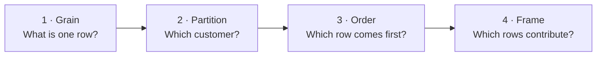
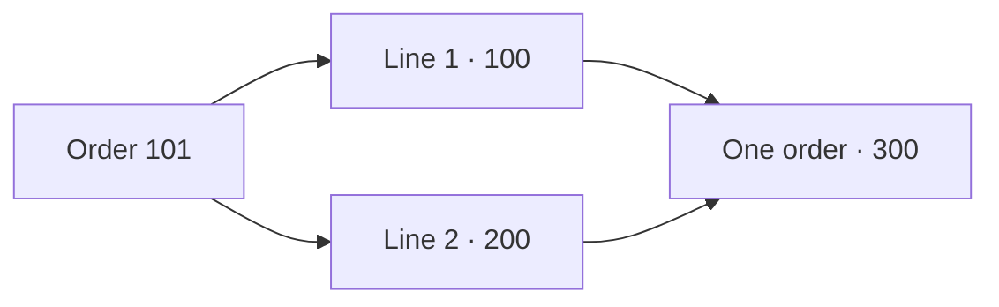
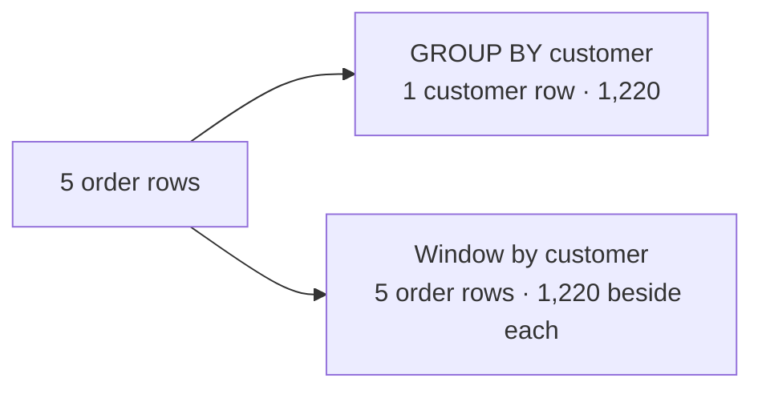
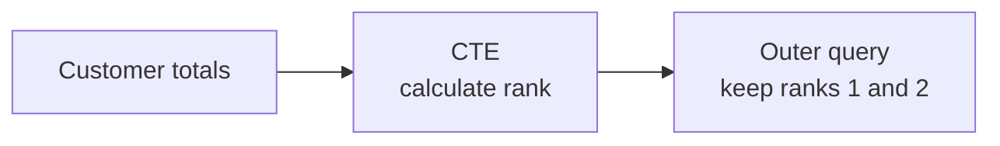

# Window functions — keep the rows, see the bigger picture

**Lab 01 · Chapter 1 · visual lesson · 60–90 minutes**

[← Lab 01 chapters](01-relational-sql.md) · [Go to tutorial & practice →](01-tutorial-practice.md)

How can you show an order **and** its customer’s total on the same row? A window function looks across related rows without collapsing the rows you started with. Follow the visuals, make a prediction, and then check it in PostgreSQL.



The interactive examples are **browser simulations** using synthetic data, not live PostgreSQL queries. The [worksheet](https://github.com/OrPerets/postgres-data-engineering-student/blob/main/labs/01-relational-sql/windows/worksheet.sql) lets you try the same ideas on the lab database. The [full lesson and optional challenges](https://github.com/OrPerets/postgres-data-engineering-student/blob/main/labs/01-relational-sql/windows/README.md) provide more detail.

## The shape of a window function

Read this example from the inside out: keep orders for each customer together, put them in a stable order, and add up the rows from the first order through the current order.

```sql
SUM(revenue) OVER (
    PARTITION BY customer_id          -- which customer's rows?
    ORDER BY order_date, order_id      -- in what order?
    ROWS BETWEEN UNBOUNDED PRECEDING AND CURRENT ROW -- which rows contribute?
) AS running_revenue
```

`OVER` turns the calculation into a window calculation: each input order stays visible. `PARTITION BY`, window `ORDER BY`, and the frame are optional where applicable; choose them according to the question. `ORDER BY` inside `OVER` does not guarantee the final display order.

<details markdown="1">
<summary>Explore common window functions</summary>

| What you want to see | Functions | What they do |
|---|---|---|
| Order rows or compare positions | `ROW_NUMBER()`, `RANK()`, `DENSE_RANK()` | Number rows; the rank functions treat peers as ties. |
| Compare neighboring rows | `LAG(value)`, `LEAD(value)` | Read an earlier or later row in the partition; return `NULL` by default when that row does not exist. |
| Add a group or moving measure | `SUM(value)`, `AVG(value)`, `COUNT(*)` | Apply an aggregate as a window without collapsing input rows. The frame determines which rows contribute. |
| Inspect a position in a frame | `FIRST_VALUE(value)`, `LAST_VALUE(value)`, `NTH_VALUE(value, n)` | Return the first, last, or *n*th value in the current frame. |
| Compare distributions or divide rows | `PERCENT_RANK()`, `CUME_DIST()`, `NTILE(n)` | Describe relative rank or divide ordered rows into buckets. `NTILE` can split tied rows across buckets. |

For example, `LAG(revenue) OVER (PARTITION BY customer_id ORDER BY order_date, order_id)` compares each order with the previous **existing order**. A unique tie-breaker makes the sequence reproducible.

In PostgreSQL, an ordered window's default frame ends at the current row's last **peer**. Without a window `ORDER BY`, the default frame covers the whole partition. So `LAST_VALUE` with the default ordered frame usually does **not** mean the last value in the whole partition. To ask for the final value of the partition, specify a full frame:

```sql
LAST_VALUE(revenue) OVER (
    PARTITION BY customer_id
    ORDER BY order_date, order_id
    ROWS BETWEEN UNBOUNDED PRECEDING AND UNBOUNDED FOLLOWING
) AS final_order_revenue
```

The `ROWS` frame uses positions in the specified ordering. Ranking functions and `LAG`/`LEAD` do not use that frame in the same way as `SUM`, `AVG`, `FIRST_VALUE`, or `LAST_VALUE`.
</details>

## 1 · Start with one row per order

An order may contain multiple item lines. Joining them can repeat the order; aggregate first when the calculation needs **one row per order**.



**Predict:** How many rows represent this order before and after aggregation? What happens if you count orders directly from the joined lines?

The worksheet includes completed orders, subtracts discounts, treats a `NULL` discount as zero, and keeps completed orders without item lines with zero revenue. Cancelled, returned and pending orders do not contribute.

## 2 · Group or window?

Five orders for one customer have revenues **300, 200, 200, 400, 120**. Their total is **1,220**.



A **partition** is the logical group of input rows for a window. `PARTITION BY customer_id` puts each customer's orders together; without it, all input rows share one partition. It is not a physical table partition.

```sql
SELECT customer_id, order_id, revenue,
       SUM(revenue) OVER (PARTITION BY customer_id) AS customer_total
FROM window_lab_order_revenue;
```

**Try it:** In worksheet section 2, add the completed-order count and each order’s share of the customer total. Predict the number of output rows. Use `NULLIF` to handle a zero total.

<details markdown="1">
<summary>See the GROUP BY version and when a window sees rows</summary>

```sql
SELECT customer_id, SUM(revenue) AS customer_total
FROM window_lab_order_revenue
GROUP BY customer_id;
```

`GROUP BY` returns one row per customer; the window adds the total to each input order row. A window sees the rows remaining after `FROM`, `WHERE`, `GROUP BY` and `HAVING` at its query level.
</details>

## 3 · Rank customers

**Predict:** If two customers tie for first place, what number should the next customer receive? Explore the ranking and change the tie-breaker. The activity shows what happens when the ordering changes.

<div id="lab01-window-ranking"></div>

<noscript>For revenues 600, 600, 300, ROW_NUMBER with customer ID as a tie-breaker gives 1, 2, 3; RANK by revenue gives 1, 1, 3; DENSE_RANK by revenue gives 1, 1, 2.</noscript>

**Your turn:** In worksheet section 3, rank customer totals within each city. Which function finds the two highest **distinct revenue levels**, including ties? Which can select exactly two customers?

<details markdown="1">
<summary>Why do ties and ordering matter?</summary>

Rows tied on every expression in the window's `ORDER BY` are **peers**. `ROW_NUMBER` gives each row a different number; use a stable tie-breaker such as `customer_id` for reproducible selection. `RANK` gives peers the same rank and leaves a gap; `DENSE_RANK` leaves no gap. Do not add a unique ID to revenue-only ranking windows when equal revenues must remain peers.

The `ORDER BY` inside `OVER` controls the window's sequence or peers. A final `ORDER BY` controls displayed order; use both where needed.
</details>

## 4 · Look at the previous order

**Predict:** What is the previous revenue for order 104? Explore the timeline, then compare what happens when you filter to March before or after calculating `LAG`.

<div id="lab01-window-lag"></div>

<noscript>Customer 1's ordered revenues are 300, 200, 200, 400, 120. LAG returns NULL, 300, 200, 200, 400. If March is filtered first, order 104 has no preceding March order; if the full history is calculated first, its previous revenue is 200.</noscript>

`LAG` reads the previous **existing order** in the ordered customer partition. The first order returns `NULL`; missing calendar months are not created. Complete worksheet section 4 and explain why moving the March filter changes the result.

<details markdown="1">
<summary>See the SQL and full order sequence</summary>

| Order | Date | Revenue | Previous revenue |
|---:|---|---:|---:|
| 101 | Jan 5 | 300 | `NULL` |
| 102 | Feb 5 | 200 | 300 |
| 103 | Feb 5 | 200 | 200 |
| 104 | Mar 1 | 400 | 200 |
| 134 | Mar 27 | 120 | 400 |

```sql
SELECT order_id, order_date, revenue,
       LAG(revenue) OVER (
           PARTITION BY customer_id ORDER BY order_date, order_id
       ) AS previous_revenue
FROM window_lab_order_revenue
WHERE customer_id = 1
ORDER BY order_date, order_id;
```

Filtering to a whole customer partition, as here, does not remove earlier orders from that customer's partition. The ID makes same-date ordering deterministic.
</details>

## 5 · Watch the frame move

A **partition** contains the customer’s orders. A **frame** is the subset used by a frame-sensitive calculation for the current row. Step through the orders and watch which rows contribute to the result.

### Predict · Build the window

Select the orders you think belong in the frame, then check your answer. This is a browser activity using the lab's synthetic data; it does not run SQL or record your answers.

<div class="lab01-h5p" markdown="1">


</div>

<noscript>Paper alternative: the ordered IDs are 101, 102, 103, 104, 134. For order 104, choose the current row and up to two preceding rows. Check your prediction with the worked example below.</noscript>

**Explore:** Now use the frame explorer to check the same idea and see the calculation move through the partition.

<div id="lab01-window-frame"></div>

<noscript>For a moving average of the current order and up to two preceding orders, the averages for orders 101, 102, 103, 104 and 134 are 300, 250, 233.33…, 266.67… and 240. For order 104, the frame contains orders 102, 103 and 104.</noscript>

**Predict:** For order 104, which three orders are in `ROWS BETWEEN 2 PRECEDING AND CURRENT ROW`? In worksheet section 5, calculate the moving average and compare it with the visual. This is a three-**order** average, not necessarily a three-month average.

<details markdown="1">
<summary>Explore same-day ties and the default frame</summary>

The two February orders share a date. Compare a row-by-row sum ordered by date **and ID** with the default ordered frame using **date only**:

| Order | Revenue | Explicit `ROWS`: date, ID | Default frame: date only |
|---:|---:|---:|---:|
| 101 | 300 | 300 | 300 |
| 102 | 200 | 500 | 700 |
| 103 | 200 | 700 | 700 |
| 104 | 400 | 1,100 | 1,100 |
| 134 | 120 | 1,220 | 1,220 |

PostgreSQL's default ordered frame runs from the partition start through the current row's **last peer**. With date-only ordering, both February orders are peers, so both are included together. Not every window function uses the frame in the same way.

The columns above change both the ordering and the frame. In worksheet section 5, isolate those choices: first compare default and explicit `ROWS` with date and ID for both; then compare them with date only for both. Date-only `ROWS` does not guarantee which tied February order receives the intermediate sum. Repeated identical results do not prove a guaranteed order; use a stable tie-breaker when needed.
</details>

## 6 · Calculate first, then filter

A window result cannot be filtered in `WHERE` at the same query level in PostgreSQL. Calculate it in a CTE or subquery, then filter outside.



**Try it:** In worksheet section 6, use customer revenue and `DENSE_RANK` to find the two highest **distinct revenue levels** per city, including ties. Consider customers with at least one completed order.

## Run the worksheet

Start the [Lab 01 environment](01-relational-sql.md), open `labs/01-relational-sql/windows/worksheet.sql` in the editor, add your answers and save. From the repository root:

```bash
make lab-sql
cd labs/01-relational-sql
docker compose exec -T postgres psql -v ON_ERROR_STOP=1 -U student -d query_lab < windows/worksheet.sql
```

The starter queries run as supplied. The worksheet is separate from the guided workspace draft; save and back it up separately.

<details markdown="1">
<summary>Trying individual queries in psql?</summary>

The worksheet creates `window_lab_order_revenue` as a **temporary view**. It exists only in the current `psql` session and disappears when that session finishes. From the lab folder, start `docker compose exec postgres psql -U student -d query_lab` and run the view definition from the top of `windows/worksheet.sql` **in that same session** before trying individual snippets. The view does not change the source tables.
</details>

## Finish and apply

Explain what one row represents, how partition and order affect the result, why the March filter changes `LAG`, and why same-day orders can share a default-frame sum. Then continue to [Tutorial & practice](01-tutorial-practice.md) and apply these ideas in questions 8–11 and 14–15, or return to the [Lab 01 chapters](01-relational-sql.md).

Explore `LAST_VALUE`, missing months, threshold crossings, and the [performance challenge](https://github.com/OrPerets/postgres-data-engineering-student/blob/main/labs/01-relational-sql/benchmarks/README.md) in the full lesson. A window function is not guaranteed to be faster; measure equivalent queries.
