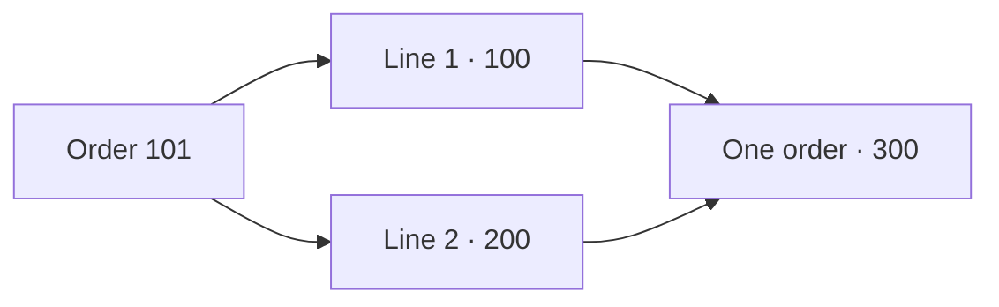
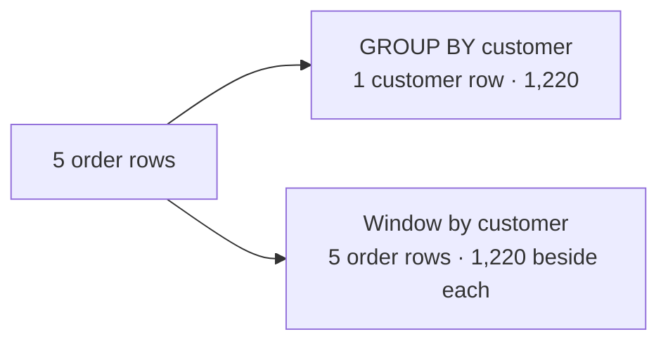
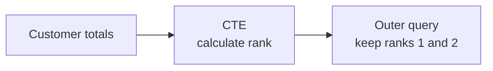

# Window functions — keep the rows, see the bigger picture

**Lab 01 · Chapter 1 · visual lesson · 60–90 minutes**

[← Lab 01 chapters](01-relational-sql.md) · [Go to tutorial & practice →](01-tutorial-practice.md)

How can you show an order **and** its customer’s total on the same row? A window function looks across related rows without collapsing the rows you started with. Follow the visuals, make a prediction, and then check it in PostgreSQL.


The interactive examples are **browser simulations** using synthetic data, not live PostgreSQL queries. The [worksheet](https://github.com/OrPerets/postgres-data-engineering-student/blob/main/labs/01-relational-sql/windows/worksheet.sql) lets you try the same ideas on the lab database. The [full lesson and optional challenges](https://github.com/OrPerets/postgres-data-engineering-student/blob/main/labs/01-relational-sql/windows/README.md) provide more detail.

## The shape of a window function

Read this example from the inside out: keep orders for each customer together, put them in a stable order, and add up the rows from the first order through the current order.

```sql
SUM(revenue) OVER (
    PARTITION BY customer_id          -- which customer's rows?
    ORDER BY order_date, order_id      -- in what order?
    ROWS BETWEEN UNBOUNDED PRECEDING AND CURRENT ROW -- which rows contribute?
) AS running_revenue
```

`OVER` turns the calculation into a window calculation: each input order stays visible. `PARTITION BY`, window `ORDER BY`, and the frame are optional where applicable; choose them according to the question. `ORDER BY` inside `OVER` does not guarantee the final display order.

## Choose a function family

| Your question | Family | Examples |
|---|---|---|
| What is the total or average around each order? | [Aggregate windows](#1-aggregate-windows) | `SUM`, `AVG`, `COUNT`, `MIN`, `MAX` |
| Which order comes first, including ties? | [Ranking](#2-ranking-functions) | `ROW_NUMBER`, `RANK`, `DENSE_RANK` |
| What happened before or after this order? | [Offsets](#3-previous-and-next-rows) | `LAG`, `LEAD` |
| What value is first, last, or nth? | [Value functions](#4-first-last-and-nth-values) | `FIRST_VALUE`, `LAST_VALUE`, `NTH_VALUE` |
| Where does this row sit in a distribution? | [Distribution and buckets](#5-distribution-and-buckets) | `PERCENT_RANK`, `CUME_DIST`, `NTILE` |

Each example below is a complete `SELECT` using **completed orders**. The source view has one row per order; examples that explicitly group it produce a different output grain. Revenue comes from the synthetic lab data; cancelled, returned and pending orders do not contribute. Set up the temporary view once before trying the examples.

<details markdown="1">
<summary>Prepare PostgreSQL for the examples</summary>

Start the lab using [Tutorial & practice](01-tutorial-practice.md), then from `labs/01-relational-sql` open one PostgreSQL session:

```bash
docker compose exec postgres psql -U student -d query_lab
```

In that **same session**, create the temporary view:

```sql
CREATE OR REPLACE TEMP VIEW window_lab_order_revenue AS
SELECT o.order_id, o.customer_id, o.order_date,
       COALESCE(SUM(i.quantity * i.unit_price *
           (1 - COALESCE(i.discount_pct, 0) / 100.0)), 0) AS revenue
FROM orders AS o
LEFT JOIN order_items AS i ON i.order_id = o.order_id
WHERE o.status = 'completed'
GROUP BY o.order_id, o.customer_id, o.order_date;
```

Keep the `psql` session open for each `SELECT`. The view disappears when the session ends; running the worksheet as a separate command does not preserve it for another session. The guided workspace runs each query in a separate read-only connection, so the temporary view will not persist there between runs. For these examples, use the same `psql` session, or put the order-revenue calculation in a CTE within a single workspace query. The view does not modify source tables. It treats a `NULL` discount as zero and keeps completed orders without item lines with zero revenue.
</details>

The PostgreSQL references cover [window functions](https://www.postgresql.org/docs/16/functions-window.html), [aggregate functions](https://www.postgresql.org/docs/16/functions-aggregate.html), and [window syntax and frames](https://www.postgresql.org/docs/16/sql-expressions.html#SYNTAX-WINDOW-FUNCTIONS).

## Foundation · Start with one row per order

An order may contain multiple item lines. Joining them can repeat the order; aggregate first when the calculation needs **one row per order**.



**Predict:** How many rows represent this order before and after aggregation? What happens if you count orders directly from the joined lines?

The worksheet includes completed orders, subtracts discounts, treats a `NULL` discount as zero, and keeps completed orders without item lines with zero revenue. Cancelled, returned and pending orders do not contribute.

## 1 · Aggregate windows

`SUM`, `AVG`, `COUNT`, `MIN`, and `MAX` can run as windows: add `OVER` to an ordinary aggregate to calculate over related rows while keeping the output rows.

Five orders for one customer have revenues **300, 200, 200, 400, 120**. Their total is **1,220**.



A **partition** is the logical group of input rows for a window. `PARTITION BY customer_id` puts each customer's orders together; without it, all input rows share one partition. It is not a physical table partition.

```sql
SELECT customer_id, order_id, revenue,
       SUM(revenue) OVER (PARTITION BY customer_id) AS customer_total
FROM window_lab_order_revenue;
```

**Try it:** In worksheet section 2, add the completed-order count and each order’s share of the customer total. Predict the number of output rows. Use `NULLIF` to handle a zero total.

<details markdown="1">
<summary>See the GROUP BY version and when a window sees rows</summary>

```sql
SELECT customer_id, SUM(revenue) AS customer_total
FROM window_lab_order_revenue
GROUP BY customer_id;
```

`GROUP BY` returns one row per customer; the window adds the total to each input order row. A window sees the rows remaining after `FROM`, `WHERE`, `GROUP BY` and `HAVING` at its query level.
</details>

<details markdown="1">
<summary>Examples · COUNT, SUM, AVG, MIN and MAX</summary>

Each of customer 1's five orders remains visible with the same customer-wide measures. `COUNT(*)` counts rows; `COUNT(revenue)` counts non-NULL revenue values. In this view revenue is never `NULL`.

```sql
SELECT order_id, order_date, revenue,
       COUNT(*) OVER customer_orders AS order_count,
       COUNT(revenue) OVER customer_orders AS known_revenue_count,
       SUM(revenue) OVER customer_orders AS customer_total,
       ROUND(AVG(revenue) OVER customer_orders, 2) AS average_revenue,
       MIN(revenue) OVER customer_orders AS smallest_order,
       MAX(revenue) OVER customer_orders AS largest_order
FROM window_lab_order_revenue
WHERE customer_id = 1
WINDOW customer_orders AS (PARTITION BY customer_id)
ORDER BY order_date, order_id;
```

Expected for every row: count **5**, total **1,220**, average **244**, minimum **120**, maximum **400**. `WINDOW` gives a shared definition a name. Without a partition (`OVER ()`), an aggregate uses all rows at this query level.
</details>

<details markdown="1">
<summary>Examples · Running totals, moving averages and FILTER</summary>

A frame can change with each row. For order 104, the running total is **1,100** and the average of orders 102, 103 and 104 is **266.67** (rounded).

```sql
SELECT order_id, order_date, revenue,
       SUM(revenue) OVER (
           PARTITION BY customer_id ORDER BY order_date, order_id
           ROWS BETWEEN UNBOUNDED PRECEDING AND CURRENT ROW
       ) AS running_total,
       ROUND(AVG(revenue) OVER (
           PARTITION BY customer_id ORDER BY order_date, order_id
           ROWS BETWEEN 2 PRECEDING AND CURRENT ROW
       ), 2) AS moving_average,
       COUNT(*) FILTER (WHERE revenue >= 300)
           OVER (PARTITION BY customer_id) AS orders_at_least_300
FROM window_lab_order_revenue
WHERE customer_id = 1
ORDER BY order_date, order_id;
```

`FILTER` changes which rows contribute to **that aggregate**, while all input order rows remain in the output. Here, the count is **2** on every row. Use `FILTER` with aggregate windows, not `ROW_NUMBER` or `LAG`.
</details>

<details markdown="1">
<summary>More aggregate windows · variability, conditions and collections</summary>

```sql
SELECT order_id, revenue,
       ROUND(STDDEV_POP(revenue) OVER customer_orders, 2) AS population_stddev,
       ROUND(VAR_POP(revenue) OVER customer_orders, 2) AS population_variance,
       ROUND(STDDEV_SAMP(revenue) OVER customer_orders, 2) AS sample_stddev,
       ROUND(VAR_SAMP(revenue) OVER customer_orders, 2) AS sample_variance,
       BOOL_OR(revenue = 0) OVER customer_orders AS has_zero_revenue,
       BOOL_AND(revenue > 0) OVER customer_orders AS all_orders_positive,
       ARRAY_AGG(order_id) OVER customer_orders AS order_ids,
       STRING_AGG(order_id::text, ', ') OVER customer_orders AS order_list
FROM window_lab_order_revenue
WHERE customer_id = 1
WINDOW customer_orders AS (
    PARTITION BY customer_id ORDER BY order_date, order_id
    ROWS BETWEEN UNBOUNDED PRECEDING AND UNBOUNDED FOLLOWING
)
ORDER BY order_date, order_id;
```

These are ordinary PostgreSQL aggregates used as windows. `STDDEV_POP` and `VAR_POP` describe population variability; `STDDEV_SAMP` and `VAR_SAMP` use sample formulas and return `NULL` for fewer than two non-NULL inputs. `BOOL_OR` tests whether any non-NULL input is true; `BOOL_AND` tests whether all non-NULL inputs are true. Both return `NULL` when there are no non-NULL inputs. Revenue in this view is never `NULL`. `ARRAY_AGG` and `STRING_AGG` collect order IDs. The explicit full frame keeps the measures constant across this ordered partition. PostgreSQL does not implement `DISTINCT` inside window aggregate calls.
</details>

### Explore · Watch the frame move

A **partition** contains the customer’s orders. A **frame** is the subset used by a frame-sensitive calculation for the current row. Step through the orders and watch which rows contribute to the result.

### Predict · Build the window

Select the orders you think belong in the frame, then check your answer. This is a browser activity using the lab's synthetic data; it does not run SQL or record your answers.

<div class="lab01-h5p" markdown="1">


</div>

<noscript>Paper alternative: the ordered IDs are 101, 102, 103, 104, 134. For order 104, choose the current row and up to two preceding rows. Check your prediction with the worked example below.</noscript>

**Explore:** Now use the frame explorer to check the same idea and see the calculation move through the partition.

<div id="lab01-window-frame"></div>

<noscript>For a moving average of the current order and up to two preceding orders, the averages for orders 101, 102, 103, 104 and 134 are 300, 250, 233.33…, 266.67… and 240. For order 104, the frame contains orders 102, 103 and 104.</noscript>

**Predict:** For order 104, which three orders are in `ROWS BETWEEN 2 PRECEDING AND CURRENT ROW`? In worksheet section 5, calculate the moving average and compare it with the visual. This is a three-**order** average, not necessarily a three-month average.

<details markdown="1">
<summary>Explore same-day ties and the default frame</summary>

The two February orders share a date. Compare a row-by-row sum ordered by date **and ID** with the default ordered frame using **date only**:

| Order | Revenue | Explicit `ROWS`: date, ID | Default frame: date only |
|---:|---:|---:|---:|
| 101 | 300 | 300 | 300 |
| 102 | 200 | 500 | 700 |
| 103 | 200 | 700 | 700 |
| 104 | 400 | 1,100 | 1,100 |
| 134 | 120 | 1,220 | 1,220 |

PostgreSQL's default ordered frame runs from the partition start through the current row's **last peer**. With date-only ordering, both February orders are peers, so both are included together. Not every window function uses the frame in the same way.

The columns above change both the ordering and the frame. In worksheet section 5, isolate those choices: first compare default and explicit `ROWS` with date and ID for both; then compare them with date only for both. Date-only `ROWS` does not guarantee which tied February order receives the intermediate sum. Repeated identical results do not prove a guaranteed order; use a stable tie-breaker when needed.
</details>

## 2 · Ranking functions

`ROW_NUMBER` numbers individual rows. `RANK` and `DENSE_RANK` compare peer groups: tied rows share a rank.

**Predict:** If two customers tie for first place, what number should the next customer receive? Explore the ranking and change the tie-breaker. The activity shows what happens when the ordering changes.

<div id="lab01-window-ranking"></div>

<noscript>For revenues 600, 600, 300, ROW_NUMBER with customer ID as a tie-breaker gives 1, 2, 3; RANK by revenue gives 1, 1, 3; DENSE_RANK by revenue gives 1, 1, 2.</noscript>

**Your turn:** In worksheet section 3, rank customer totals within each city. Which function finds the two highest **distinct revenue levels**, including ties? Which can select exactly two customers?

<details markdown="1">
<summary>Why do ties and ordering matter?</summary>

Rows tied on every expression in the window's `ORDER BY` are **peers**. `ROW_NUMBER` gives each row a different number; use a stable tie-breaker such as `customer_id` for reproducible selection. `RANK` gives peers the same rank and leaves a gap; `DENSE_RANK` leaves no gap. Do not add a unique ID to revenue-only ranking windows when equal revenues must remain peers.

The `ORDER BY` inside `OVER` controls the window's sequence or peers. A final `ORDER BY` controls displayed order; use both where needed.
</details>

<details markdown="1">
<summary>Example · Compare ROW_NUMBER, RANK and DENSE_RANK</summary>

```sql
SELECT order_id, revenue,
       ROW_NUMBER() OVER (ORDER BY revenue DESC, order_id) AS row_number,
       RANK() OVER (ORDER BY revenue DESC) AS revenue_rank,
       DENSE_RANK() OVER (ORDER BY revenue DESC) AS revenue_dense_rank
FROM window_lab_order_revenue
WHERE customer_id = 1
ORDER BY revenue DESC, order_id;
```

The revenues are 400, 300, 200, 200, 120. The two 200 orders share rank **3**; the next rank is **5**, while the next dense rank is **4**. The ID appears only in `ROW_NUMBER`'s ordering so that the other windows preserve equal-revenue peers. A `ROW_NUMBER` ordering with a unique ID makes the result reproducible.
</details>

## 3 · Previous and next rows

`LAG` looks backward and `LEAD` looks forward within the ordered partition. Both use existing rows, not a calendar interval.

**Predict:** What is the previous revenue for order 104? Explore the timeline, then compare what happens when you filter to March before or after calculating `LAG`.

<div id="lab01-window-lag"></div>

<noscript>Customer 1's ordered revenues are 300, 200, 200, 400, 120. LAG returns NULL, 300, 200, 200, 400. If March is filtered first, order 104 has no preceding March order; if the full history is calculated first, its previous revenue is 200.</noscript>

`LAG` reads the previous **existing order** in the ordered customer partition. The first order returns `NULL`; missing calendar months are not created. Complete worksheet section 4 and explain why moving the March filter changes the result.

<details markdown="1">
<summary>See the SQL and full order sequence</summary>

| Order | Date | Revenue | Previous revenue |
|---:|---|---:|---:|
| 101 | Jan 5 | 300 | `NULL` |
| 102 | Feb 5 | 200 | 300 |
| 103 | Feb 5 | 200 | 200 |
| 104 | Mar 1 | 400 | 200 |
| 134 | Mar 27 | 120 | 400 |

```sql
SELECT order_id, order_date, revenue,
       LAG(revenue) OVER (
           PARTITION BY customer_id ORDER BY order_date, order_id
       ) AS previous_revenue
FROM window_lab_order_revenue
WHERE customer_id = 1
ORDER BY order_date, order_id;
```

Filtering to a whole customer partition, as here, does not remove earlier orders from that customer's partition. The ID makes same-date ordering deterministic.
</details>

<details markdown="1">
<summary>Example · LAG, LEAD, an offset and a default</summary>

```sql
SELECT order_id, order_date, revenue,
       LAG(revenue) OVER customer_order AS previous_revenue,
       LEAD(revenue) OVER customer_order AS next_revenue,
       LAG(revenue, 2, 0::numeric) OVER customer_order AS two_orders_back_or_zero
FROM window_lab_order_revenue
WHERE customer_id = 1
WINDOW customer_order AS (PARTITION BY customer_id ORDER BY order_date, order_id)
ORDER BY order_date, order_id;
```

For order 104, the previous revenue is **200**, the next is **120**, and two orders back is **200**. The third argument is used only when the requested row does **not exist**. If the target row exists but its value is `NULL`, it remains `NULL`; PostgreSQL does not support the SQL-standard `IGNORE NULLS` option here. The functions use the partition and order, not the window frame.
</details>

## 4 · First, last and nth values

`FIRST_VALUE`, `LAST_VALUE` and `NTH_VALUE` read from the **current frame**. Use a full frame when the question asks about the first, last, or nth order in the whole customer history.

<details markdown="1">
<summary>Example · Compare the first, last and third order</summary>

```sql
SELECT order_id, order_date, revenue,
       FIRST_VALUE(revenue) OVER full_history AS first_revenue,
       LAST_VALUE(revenue) OVER full_history AS final_revenue,
       NTH_VALUE(revenue, 3) OVER full_history AS third_revenue
FROM window_lab_order_revenue
WHERE customer_id = 1
WINDOW full_history AS (
    PARTITION BY customer_id ORDER BY order_date, order_id
    ROWS BETWEEN UNBOUNDED PRECEDING AND UNBOUNDED FOLLOWING
)
ORDER BY order_date, order_id;
```

For all five orders, the first revenue is **300**, the last is **120**, and the third is **200**. `NTH_VALUE` returns `NULL` when the requested position is outside the frame.

**Default-frame surprise:** With `ORDER BY` and no explicit frame, PostgreSQL's frame ends at the current row's last peer. Thus `LAST_VALUE` often returns the current value rather than the final value in the partition. Without window `ORDER BY`, the default frame is the full partition, but no chronological first or last is defined. PostgreSQL respects `NULL` values for these functions; it does not implement `IGNORE NULLS` or `NTH_VALUE ... FROM LAST`.
</details>

## 5 · Distribution and buckets

`PERCENT_RANK` and `CUME_DIST` locate a row relative to its partition; `NTILE` divides ordered rows into a requested number of roughly equal-sized buckets.

<details markdown="1">
<summary>Example · Compare percent rank, cumulative distribution and buckets</summary>

```sql
SELECT order_id, revenue,
       PERCENT_RANK() OVER (ORDER BY revenue DESC) AS percent_rank,
       CUME_DIST() OVER (ORDER BY revenue DESC) AS cumulative_distribution,
       NTILE(3) OVER (ORDER BY revenue DESC, order_id) AS revenue_bucket
FROM window_lab_order_revenue
WHERE customer_id = 1
ORDER BY revenue DESC, order_id;
```

For customer 1, the descending revenues are **400, 300, 200, 200, 120**. Both 200 rows are peers: each has percent rank **0.5** and cumulative distribution **0.8**. `PERCENT_RANK` is `(rank − 1) / (partition rows − 1)` and returns 0 for a one-row partition. `CUME_DIST` counts rows through the current peer group, divided by the partition size.

`NTILE(3)` assigns bucket numbers **1, 1, 2, 2, 3** here. It counts rows and can split equal values between buckets. The ID makes this example's bucket assignment reproducible; it is deliberately absent from the two distribution orderings so equal revenues remain peers.
</details>

## Apply · Calculate first, then filter

A window result cannot be filtered in `WHERE` at the same query level in PostgreSQL. Calculate it in a CTE or subquery, then filter outside.



**Try it:** In worksheet section 6, use customer revenue and `DENSE_RANK` to find the two highest **distinct revenue levels** per city, including ties. Consider customers with at least one completed order.

<details markdown="1">
<summary>Example · Filter a ranking after it is calculated</summary>

```sql
WITH customer_totals AS (
    SELECT c.customer_id, c.city, SUM(r.revenue) AS total_revenue
    FROM customers AS c
    JOIN window_lab_order_revenue AS r ON r.customer_id = c.customer_id
    GROUP BY c.customer_id, c.city
), ranked AS (
    SELECT customer_id, city, total_revenue,
           DENSE_RANK() OVER (
               PARTITION BY city ORDER BY total_revenue DESC
           ) AS revenue_rank
    FROM customer_totals
)
SELECT customer_id, city, total_revenue, revenue_rank
FROM ranked
WHERE revenue_rank <= 2
ORDER BY city, revenue_rank, customer_id;
```

First the CTE makes one revenue total per customer, then the window ranks those totals within each city, and finally the outer query keeps the top two distinct revenue levels—including ties. The join includes only customers with at least one completed order; a `NULL` city forms its own partition.
</details>

## Run the worksheet

Start the [Lab 01 environment](01-relational-sql.md), open `labs/01-relational-sql/windows/worksheet.sql` in the editor, add your answers and save. From the repository root:

```bash
make lab-sql
cd labs/01-relational-sql
docker compose exec -T postgres psql -v ON_ERROR_STOP=1 -U student -d query_lab < windows/worksheet.sql
```

The starter queries run as supplied. The worksheet is separate from the guided workspace draft; save and back it up separately.

<details markdown="1">
<summary>Trying individual queries in psql?</summary>

The worksheet creates `window_lab_order_revenue` as a **temporary view**. It exists only in the current `psql` session and disappears when that session finishes. From the lab folder, start `docker compose exec postgres psql -U student -d query_lab` and run the view definition from the top of `windows/worksheet.sql` **in that same session** before trying individual snippets. The view does not change the source tables.
</details>

## Finish and apply

Explain what one row represents, how partition and order affect the result, why the March filter changes `LAG`, and why same-day orders can share a default-frame sum. Then continue to [Tutorial & practice](01-tutorial-practice.md) and apply these ideas in questions 8–11 and 14–15, or return to the [Lab 01 chapters](01-relational-sql.md).

Explore `LAST_VALUE`, missing months, threshold crossings, and the [performance challenge](https://github.com/OrPerets/postgres-data-engineering-student/blob/main/labs/01-relational-sql/benchmarks/README.md) in the full lesson. A window function is not guaranteed to be faster; measure equivalent queries.
