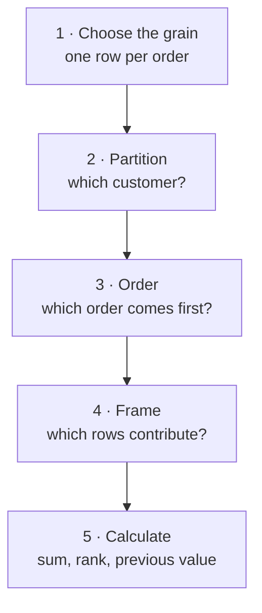
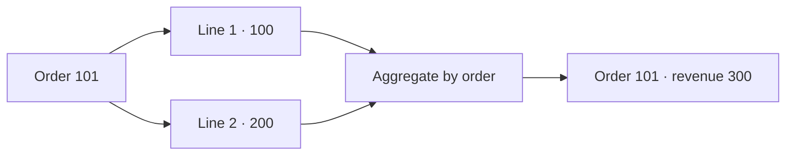
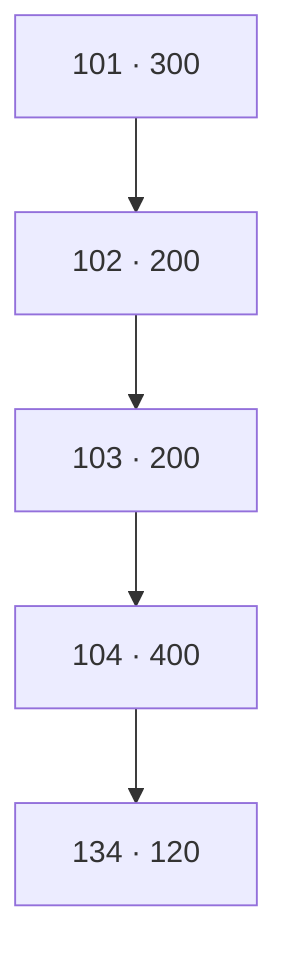
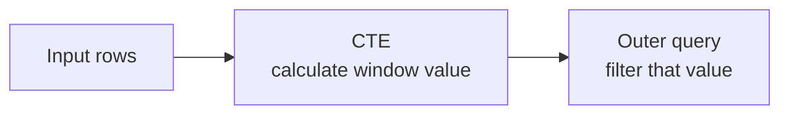

# Window Functions — See the Rows Behind the Result

**Lab 01 · guided lesson · 60–90 minutes**

A window function lets you calculate across related rows while keeping each input row visible. In this lesson you will follow real orders, predict what a query will return, and check your ideas in PostgreSQL.

**You will need:** the [Lab 01 environment](01-relational-sql.md), the [SQL worksheet](https://github.com/OrPerets/postgres-data-engineering-student/blob/main/labs/01-relational-sql/windows/worksheet.sql), and the [full lesson and challenges](https://github.com/OrPerets/postgres-data-engineering-student/blob/main/labs/01-relational-sql/windows/README.md). The examples use the lab's synthetic data, not actual customer records.



Read the diagram from top to bottom. The frame matters for calculations such as `SUM`, `AVG`, and `LAST_VALUE`; not every window function uses the frame in the same way.

## Start the worksheet

From the repository root, start Lab 01. Then go to its folder and run the worksheet:

```bash
make lab-sql
cd labs/01-relational-sql
docker compose exec -T postgres psql -v ON_ERROR_STOP=1 -U student -d query_lab < windows/worksheet.sql
```

The starter queries run as supplied. Open `labs/01-relational-sql/windows/worksheet.sql` in the Codespace editor, add your answers, save, and run the command again. The worksheet is separate from the Lab 01 guided workspace draft; save and back it up separately.

The worksheet creates `window_lab_order_revenue` as a **temporary view**. It exists only for that `psql` session and disappears when the command finishes. To try the snippets below interactively, start `docker compose exec postgres psql -U student -d query_lab` from the lab folder and run the view definition from the top of `windows/worksheet.sql` **in that same session**. The view does not change the source tables.

## 1 · Choose your grain

An order can have multiple item lines. If you join orders to item lines, an order may appear more than once. First calculate **one revenue value per completed order**, then apply a window over orders.



The worksheet uses the Lab 01 business rule: include completed orders, subtract the discount, and treat a `NULL` discount as zero. A completed order with no item lines remains in the order-level view with zero revenue. Cancelled, returned, and pending orders do not contribute.

**Predict:** After the join, how many rows represent order 101? How many after aggregation? What might happen if you count orders directly from joined item rows? Run section 1 of the worksheet and check.

## 2 · `GROUP BY` versus a window

For customer 1, the completed orders have revenues **300, 200, 200, 400, 120**. Both queries can calculate the customer total, but their outputs have different grains:

| Input: five order rows | `GROUP BY customer_id` | `SUM(...) OVER (PARTITION BY customer_id)` |
|---|---|---|
| Each row is an order | One customer row: **1,220** | Five order rows, each showing **1,220** |
| Order detail is available | Order detail is collapsed | Order detail is kept |

With the temporary view available in your session:

```sql
-- A customer summary
SELECT customer_id, SUM(revenue) AS customer_total
FROM window_lab_order_revenue
GROUP BY customer_id;

-- The same customer total beside each order
SELECT customer_id, order_id, revenue,
       SUM(revenue) OVER (PARTITION BY customer_id) AS customer_total
FROM window_lab_order_revenue
ORDER BY customer_id, order_date, order_id;
```

A **partition** is the group of input rows used by a window, not a physical table partition. Without `PARTITION BY`, all input rows are in one partition. The window sees rows remaining after `FROM`, `WHERE`, `GROUP BY`, and `HAVING` at its query level.

**Try it:** In worksheet section 2, add the number of completed orders and each order's share of customer revenue. What does a zero customer total mean for the share? Use `NULLIF` to avoid division by zero.

## 3 · Order and peers: ranking

Rows tied on every expression in a window's `ORDER BY` are **peers**. Here is a small illustration with two equal scores:

| Customer | Revenue | `ROW_NUMBER` with customer ID as tie-breaker | `RANK` by revenue | `DENSE_RANK` by revenue |
|---|---:|---:|---:|---:|
| A | 600 | 1 | 1 | 1 |
| B | 600 | 2 | 1 | 1 |
| C | 300 | 3 | 3 | 2 |

- `ROW_NUMBER` assigns a different number to each row. Add a stable tie-breaker when you need reproducible selection.
- `RANK` gives peers the same rank and leaves a gap after a tie.
- `DENSE_RANK` gives peers the same rank and counts distinct rank levels without gaps.

**Predict:** Which function would return the two highest *distinct revenue levels*, including ties? Which would select exactly two customers? In worksheet section 3, rank actual customer totals within each city. Use `customer_id` as a tie-breaker for `ROW_NUMBER`, but do not add it to the revenue-only ranking windows: doing so would break the revenue ties.

The `ORDER BY` **inside** `OVER` controls the window's sequence or peers. A final `ORDER BY` controls the order in which results are displayed; use both where needed.

## 4 · Look backward with `LAG`

Customer 1's order history, sorted by date and then ID:

| Order | Date | Revenue | Previous order revenue |
|---:|---|---:|---:|
| 101 | Jan 5 | 300 | `NULL` |
| 102 | Feb 5 | 200 | 300 |
| 103 | Feb 5 | 200 | 200 |
| 104 | Mar 1 | 400 | 200 |
| 134 | Mar 27 | 120 | 400 |



`LAG(revenue)` reads the previous **existing order** in the customer's ordered partition. It returns `NULL` for the first order; it does not create missing calendar months.

```sql
SELECT order_id, order_date, revenue,
       LAG(revenue) OVER (
           PARTITION BY customer_id ORDER BY order_date, order_id
       ) AS previous_revenue
FROM window_lab_order_revenue
WHERE customer_id = 1
ORDER BY order_date, order_id;
```

**Predict and test:** If you filter to March *before* calculating `LAG`, what does order 104 see? What if you calculate `LAG` over the full order history first and filter to March in an outer query? Complete worksheet section 4 and explain the difference. Filtering to a whole customer partition, as above, does not remove earlier orders from that customer's partition.

## 5 · See the frame move

For the three-order moving average, the frame is the current order plus **up to two preceding orders**. Its size grows until three orders are available:

| Current order | Rows in `ROWS BETWEEN 2 PRECEDING AND CURRENT ROW` | Average revenue |
|---:|---|---:|
| 101 | **101** | 300 |
| 102 | **101 · 102** | 250 |
| 103 | **101 · 102 · 103** | 233.33… |
| 104 | **102 · 103 · 104** | 266.67… |
| 134 | **103 · 104 · 134** | 240 |

This is a three-**order** average, not necessarily a three-month average. `ROWS` uses positions in the window order. Include a stable tie-breaker, such as `order_id`, when dates can tie.

### The same-day surprise: default frame and `ROWS`

The two February orders share the same date. Compare a row-by-row sum ordered by date **and ID** with the default frame ordered by **date only**:

| Order | Revenue | Explicit `ROWS`: date, ID | Default ordered frame: date only |
|---:|---:|---:|---:|
| 101 | 300 | 300 | 300 |
| 102 | 200 | 500 | 700 |
| 103 | 200 | 700 | 700 |
| 104 | 400 | 1,100 | 1,100 |
| 134 | 120 | 1,220 | 1,220 |

With an ordered window, PostgreSQL's default frame runs from the partition start through the current row's **last peer**. For date-only ordering, both February orders are peers, so each includes both February values.

**Important experiment:** The two columns above change both ordering and frame. In worksheet section 5, isolate the choices:

1. Compare default and explicit `ROWS` using **date and ID** for both.
2. Compare the same frames using **date only** for both.
3. Explain why date-only `ROWS` does not guarantee which tied February order receives the intermediate sum. Seeing the same output twice does not establish a guaranteed order.

## 6 · Filter after the window

You cannot filter a window result in `WHERE` at the same query level in PostgreSQL. Compute it in a subquery or common table expression (CTE), then filter the result outside:



For example, after calculating a `ROW_NUMBER` in a CTE, an outer `WHERE` can select the first two orders per customer. In worksheet section 6, use customer revenue and `DENSE_RANK` to find the two highest **distinct revenue levels** per city, including ties. Consider only customers with at least one completed order.

## Finish and explore

Before returning to Lab 01 questions 8–11 and 14–15, explain aloud:

1. What does one input row represent? How would the result change at item-line grain?
2. How do partition, order, peers, and frame affect your answer?
3. Why can `LAG` change when a date filter moves before the window?
4. Why can the two same-day orders have equal default-frame sums?

Continue with the optional `LAST_VALUE`, missing-month, threshold-crossing, and [performance](https://github.com/OrPerets/postgres-data-engineering-student/blob/main/labs/01-relational-sql/benchmarks/README.md) challenges in the full lesson. A window function is not guaranteed to be faster; the benchmark is a measured example, not a universal rule.
