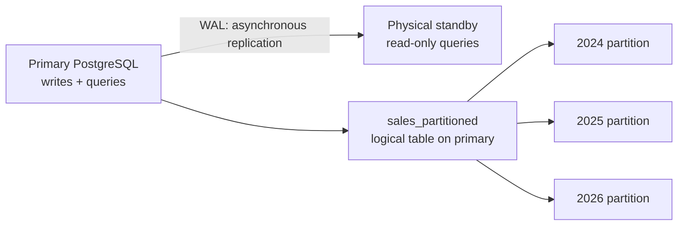

# Lab 02 — Partitioning & Replication

> **Your mission:** Keep analytical queries efficient as sales data grows, while separating reporting workloads from ETL writes.

**You will practice:** RANGE partitions, partition pruning, physical PostgreSQL replication, replication lag, and analytical Window Functions.

!!! info "Your work"

    Choose **one** route after `make lab-partitions` finishes. The guided draft and the original `sql/student_exercises.sql` worksheet are separate copies and do not automatically sync. A query runs the SQL selected in the workspace or entered at the terminal, not the other copy.

    **Route A — Guided workspace:** From the repository root, run `make lab-partitions-workspace`. Keep that terminal running, then open private port **8766** from the Codespace **Ports** tab. Write your draft, select **Primary** or **Replica** for each statement, and check which server is shown with its result. Use **Save answers** regularly; edits are not autosaved. Use **Download SQL** to keep a copy outside the Codespace, and label your Primary and Replica statements with SQL comments.

    **Run carefully:** Primary read mode rolls back; the explicit apply action commits a successful statement to Primary, including DDL and inserts. The Replica handles writes as a real standby and rejects them. Each run is one statement in its own transaction; use the terminal for an interactive multi-statement transaction. Replication is asynchronous, so a new Primary row may take time to appear on Replica.

    **Route B — Codespace editor:** In Explorer, edit `labs → 02-partitioning-replication → sql → student_exercises.sql` and save it with **Ctrl+S** (Windows/Linux) or **⌘S** (Mac). To check its statements, open a SQL prompt on the appropriate server. From the repository root, first run `cd labs/02-partitioning-replication`, then use the relevant command:

    ```bash
    docker compose exec primary psql -U lab -d engineering
    docker compose exec replica psql -U lab -d engineering
    ```

    Copy selected statements from your saved worksheet into the correct prompt, not the entire mixed worksheet. Use Primary for writes. Run the exercise that attempts a write on the read-only Replica separately; it should produce an error. Exit each `psql` prompt with `\q` before opening another. Download the saved worksheet from Explorer or commit and push it to your own fork to keep a copy outside the Codespace.

    **Check for either route:** From the repository root, `make test LAB=02-partitioning-replication` checks that the sales tables contain data and that Primary and Replica report the expected roles; it does not test either answer copy. Neither this check nor the workspace grades your SQL, and saving or downloading does not submit your work.

    **Prepare your work:** Keep your completed SQL with answers A1–D1 and Primary/Replica labels, plus a brief `report.md` or PDF with timings, execution plans, screenshots and the D2 explanation, as described in the [assignment](https://github.com/OrPerets/postgres-data-engineering-student/blob/main/labs/02-partitioning-replication/assignments/STUDENT_ASSIGNMENT.md). On Route A, **Download SQL** exports the draft as `lab02_student_exercises.sql`; prepare and back up the report separately. **Download results CSV**, when useful as additional evidence, includes only the displayed rows. On Route B, back up the saved worksheet and report from Explorer or your own fork.

    **Back up and submit:** Guided drafts live in `.workspace-data/`, which Git ignores; committing or pushing the original worksheet does not back up the guided draft. Download your SQL, report and required evidence outside the Codespace. The assignment names `student_exercises.sql`; if your instructor asks for that filename, rename a copy of the downloaded SQL without overwriting your original worksheet. Follow your instructor's submission method and deadline. See [environment setup](../getting-started.md) and [troubleshooting](../troubleshooting.md).

## 1. Get ready

In GitHub Codespaces, **from the repository root**:

```bash
make lab-partitions
```

The initializer starts a Primary and a Read Replica, creates the sales tables, and prepares synthetic data. It preserves existing tables when already initialized.

[Open lab files](https://github.com/OrPerets/postgres-data-engineering-student/tree/main/labs/02-partitioning-replication) · [Complete student assignment](https://github.com/OrPerets/postgres-data-engineering-student/blob/main/labs/02-partitioning-replication/assignments/STUDENT_ASSIGNMENT.md)

### Checkpoint — Both servers ready?

From the repository root:

```bash
cd labs/02-partitioning-replication
docker compose ps
docker compose exec -T primary psql -U lab -d engineering -c "SELECT pg_is_in_recovery();"
docker compose exec -T replica psql -U lab -d engineering -c "SELECT pg_is_in_recovery();"
```

**Expected:** Primary returns `f`; Replica returns `t`.

## 2. Understand — Partitioning is not replication

- **Partitioning:** Organizes one logical table into physical subsets, often by date.
- **Replication:** Maintains a read-only standby by replaying Primary changes.
- **SQL window PARTITION BY:** Defines logical groups for calculation; it does **not** create physical table partitions.

### See how the pieces connect



A write goes to the primary. PostgreSQL routes a row in `sales_partitioned` to a yearly partition using its `sale_date`: each partition includes its start date and excludes the next year's start date. A suitable date predicate can let PostgreSQL skip partitions that cannot match. Physical replication replays the primary's changes on a standby; the standby can lag and also contains the replicated table and partitions. This diagram is conceptual—use `EXPLAIN` and replication views to inspect your running lab.

[Try the interactive partitioning explorer and practice quiz](../activities/lab02-learning-pack.md). These browser examples are separate simulations and do not connect to your PostgreSQL servers.

### Predict before running

A query asks for transactions from January to March 2025. Which yearly partitions should PostgreSQL read? What if the filter uses only `customer_id`?

## 3. Explore the query plan

From `labs/02-partitioning-replication`:

```bash
docker compose exec -T primary psql -U lab -d engineering < sql/02_partition_experiments.sql
```

Examine `EXPLAIN (ANALYZE, BUFFERS)`. Compare relations scanned, buffer usage and timing.

**Checkpoint:** Does filtering by the partition key exclude irrelevant partitions? If not, inspect the predicate and pruning settings.

**Hint:** Partition pruning can save work, but a small table may still be faster without elaborate partitioning.

## 4. Investigate the Read Replica

Insert a new row **on Primary** and query it on Replica. Inspect replication status on Primary with `pg_stat_replication`.

**Predict:** Can you write directly to Replica? Does it always show a committed Primary row immediately?

**Checkpoint:** Explain asynchronous lag and why a replica is neither a backup nor automatic failover.

## 5. Complete the SQL exercises

Work in the guided workspace or in your Codespace copy of [sql/student_exercises.sql](https://github.com/OrPerets/postgres-data-engineering-student/blob/main/labs/02-partitioning-replication/sql/student_exercises.sql). The assignment covers monthly partition creation, replica diagnostics, running totals, ranking, `LAG`, moving averages and a combined pruning/window query.

### Optional hints for the assignment

Try each task yourself first. Expand a hint if you need a direction; the hints do not contain the full answers.

#### A. Partitioning

<details><summary>A1 — Partition names and bounds</summary><p>Look for PostgreSQL's catalog information about partition relationships and bounds. Identify the parent table before listing its children.</p></details>

<details><summary>A2 — Yearly counts and revenue</summary><p>Think about one output row per year. Count transactions and sum amounts, then group and order by the same year definition.</p></details>

<details><summary>A3 — Compare one quarter</summary><p>Use equivalent date bounds and aggregation on both tables. Compare the results before interpreting the plans, then inspect which child relations PostgreSQL scanned or pruned.</p></details>

<details><summary>A4 — Monthly partitions for 2025</summary><p>Define non-overlapping monthly boundaries that cover all of 2025. Load only rows in that year, then compare counts and values with the regular table.</p></details>

<details><summary>A5 — One month versus a full year</summary><p>Predict which monthly partitions can overlap each date range. Compare plans and consider selectivity, table size and overhead before deciding whether an index helps.</p></details>

<details><summary>A6 — Route 2027 rows</summary><p>Use a 2027 range that begins where the 2026 range ends. Write on the primary, then check the child receiving each new row.</p></details>

#### B. Replication

<details><summary>B1 — Identify each server</summary><p>Run the same recovery-status check on both connections. A primary and a standby report different roles.</p></details>

<details><summary>B2 — Observe a replicated write</summary><p>Use a new identifier, commit the transaction on the primary, then read the same identifier on the standby. Record the observation and retry interval; one run does not establish a universal lag.</p></details>

<details><summary>B3 — Inspect replication positions</summary><p>Query the primary's replication status and compare sent and replayed WAL positions using PostgreSQL's position-difference function. Interpret a byte gap as a position difference, not elapsed time.</p></details>

<details><summary>B4 — Inspect receiver and replay time</summary><p>Run these checks on the standby. A replay timestamp can be old simply because the primary has been idle, so elapsed time since replay is not always a measure of current lag.</p></details>

<details><summary>B5 — Read-only standby</summary><p>Run the attempted write separately on the standby and record the error. Explain why a standby that replays changes is not a substitute for a recoverable backup.</p></details>

#### C. Window functions

<details><summary>C1 — Customer running total</summary><p>Keep one row per transaction. Group the window by customer and choose a stable order that includes both the date and the sale ID.</p></details>

<details><summary>C2 — Three largest transactions</summary><p>Rank rows separately for each customer, using amount and a stable tie-breaker. Then filter the numbered rows in an outer query.</p></details>

<details><summary>C3 — Monthly revenue and previous month</summary><p>Build a complete month series first and attach aggregated revenue to it. Apply the previous-row calculation after filling missing months so adjacent rows really are adjacent months.</p></details>

<details><summary>C4 — Days since the previous transaction</summary><p>For each customer, identify the previous sale date in a deterministic order, then compare it with the current date. Consider the first transaction and same-day sales.</p></details>

<details><summary>C5 — Monthly customer ranking</summary><p>Aggregate to one row per customer per month before ranking. Rank within each month by revenue without adding a tie-breaking expression to the rank; filter January afterward so ties remain tied.</p></details>

<details><summary>C6 — Three-month moving average</summary><p>Create a complete month calendar and one global revenue value per month before applying the specified three-row frame. Consider how many months contribute at the beginning of the series.</p></details>

<details><summary>C7 — Two kinds of partition</summary><p>Contrast physical storage and pruning of table partitions with logical groups inside an analytical window. Give an example in which the grouping column and the storage partition key differ.</p></details>

#### D. Integration

<details><summary>D1 — Pruning plus a window</summary><p>Use a date predicate that the partition key can support, and apply a window to the rows in the selected scope. Compare both result and plan on the two servers; caching and timing alone cannot prove a replication effect.</p></details>

<details><summary>D2 — Route writes and reads</summary><p>Sketch the primary and standby connections, then explain what a reader might observe during replay lag. A standby failure alone does not establish primary data loss; also consider shared failures and backups.</p></details>

### Before moving on

- Can you distinguish physical partitions from logical window partitions?
- Can you explain why filtering by a partition key changes the plan?
- Can you route ETL writes to Primary and BI reads to Replica?

## Job interview questions

Try answering aloud before expanding each suggested answer. Connect your answer to what you observed in the lab.

<details><summary>1. What is partition pruning, and when can it help?</summary><p>PostgreSQL can skip table partitions that cannot contain rows matching a query's conditions. A suitable filter on the partition key, such as a date range on a table partitioned by sale date, can reduce work. Check the plan: performance still depends on data size, selectivity and other costs.</p></details>

<details><summary>2. Is a table partition the same as PARTITION BY in a window function?</summary><p>No. Table partitioning organizes a logical table into physical child partitions and can enable pruning. Window <code>PARTITION BY</code> groups rows for a calculation such as a running total; it does not create or change physical table partitions.</p></details>

<details><summary>3. What can a client observe when reading from an asynchronous replica?</summary><p>The replica may not yet have replayed a recently committed write, so a read can return older data. Route writes to the primary and choose a consistency strategy appropriate to the application, such as reading from the primary when immediate read-after-write consistency is required.</p></details>

<details><summary>4. Why is a replica not a substitute for a backup?</summary><p>Replication copies changes, including accidental deletes or corrupt data, to the standby; shared failures can also affect both servers. A recoverable backup and tested restore process protect against different failure scenarios. A standby alone also does not provide automatic failover.</p></details>

<details><summary>5. How can a window function calculate a running sales total per customer?</summary><p>Use <code>SUM(amount) OVER (PARTITION BY customer_id ORDER BY sale_date, sale_id ROWS BETWEEN UNBOUNDED PRECEDING AND CURRENT ROW)</code>. It keeps one result per sale while accumulating that customer's sales in a stable order.</p></details>

<details><summary>6. When would you use LAG, and what should you consider when comparing months?</summary><p><code>LAG</code> reads a value from a previous row in the ordered partition, for example to compare monthly revenue with the previous month. It returns the previous available row, not necessarily the previous calendar month: build a complete month series first if missing months must be included.</p></details>

<details><summary>7. How would you compute a three-month moving average?</summary><p>First aggregate sales to one row per month and fill missing months if they count in the calculation. Then apply <code>AVG</code> with an ordered <code>ROWS BETWEEN 2 PRECEDING AND CURRENT ROW</code> frame. The first two rows have fewer than three months in their frames unless you provide earlier history.</p></details>

<details><summary>8. Does filtering dates before a window calculation change the answer?</summary><p>It can: a window sees the rows that remain after the query level's <code>WHERE</code>. Filtering to one month before calculating a running total starts the total within that month. To calculate over a longer history but display only one month, compute the window in a subquery or CTE and apply the display filter outside it.</p></details>

**Submit:** Your SQL, execution-plan evidence, and the explanations required by the assignment.

**Next:** [Lab 03 — DWH & ETL](03-dwh-etl.md).
