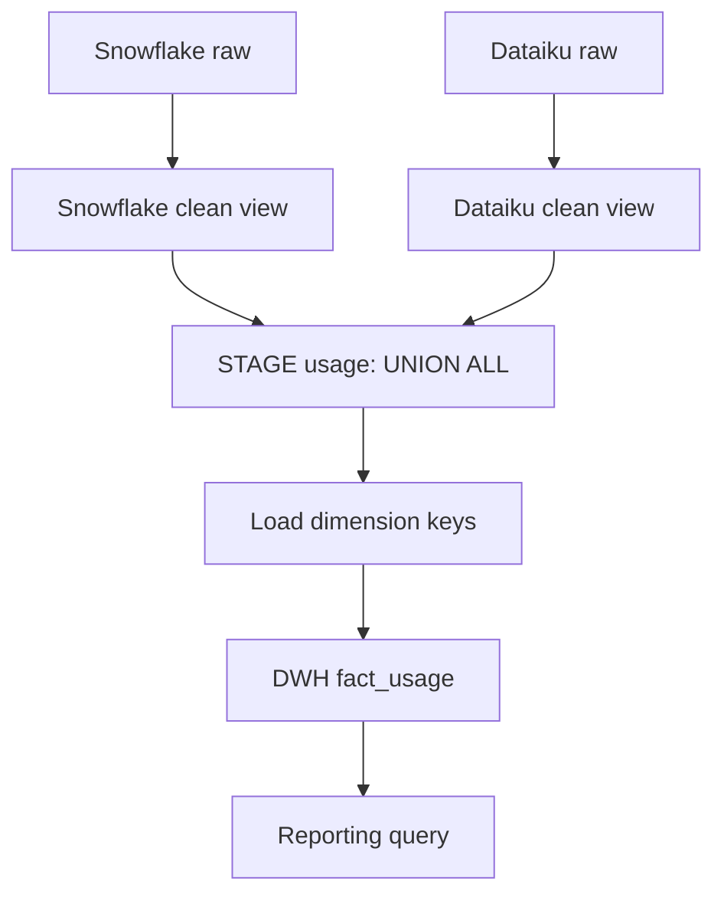

# Lab 03 — Data Warehouse & ETL

> **Your mission:** Convert two incompatible source feeds into a reliable dimensional warehouse without silently inventing missing facts.

**You will practice:** Source-to-target mapping, staging, data quality, dimensional modeling, fact grain and repeatable loads.

## 1. Get ready

From the repository root in Codespaces:

```bash
make lab-dwh
```

[Open Lab 03](https://github.com/OrPerets/postgres-data-engineering-student/tree/main/labs/03-dwh-etl) · [Full assignment](https://github.com/OrPerets/postgres-data-engineering-student/blob/main/labs/03-dwh-etl/STUDENT_ASSIGNMENT.md)

### Checkpoint — Did the pipeline load?

```bash
cd labs/03-dwh-etl
docker compose exec -T postgres psql -U student -d dwh_etl_lab < sql/03_verify.sql
```

**Expected with the supplied sample:** five Snowflake observations and five Dataiku observations; ten unified staging records. These are *sample rows*, not evidence of source completeness.

## 2. Follow one record through three layers

```text
SRC (raw text)
    ↓
STAGE (typed views + quality flags)
    ↓
DWH (dimensions + fact_usage)
```

- **SRC:** Original fields and source-specific meanings.
- **STAGE:** Standardized names and types, built as views; no physical copy.
- **DWH:** Surrogate dimension keys and stored source-observation facts.

### Predict

What happens when an estimated cost is empty? Is it zero, missing, or invalid? Why must `source_code` be retained when comparing identities across systems?

## 3. Inspect transformations

Run queries against `STAGE_SCHEMA.snowflake_clean`, `STAGE_SCHEMA.dataiku_clean`, and `STAGE_SCHEMA.usage`.

**Checkpoint:** Explain why `UNION ALL` preserves both feeds rather than joining or deduplicating them.

**Hint:** `NULL` for cost means "unknown"; `0` means a known zero cost.

## 4. Trace a fact row

Find the sample with `batch_id='dk-sample-v1'` and `row_no=4`. Join `DWH_SCHEMA.fact_usage` to the user, source, model and entity dimensions.

**Checkpoint:** Does its missing cost stay missing? Why is a source natural key different from a DWH surrogate key?

## 5. Test the engineering behavior

Rerun `sql/02_dwh.sql` **only after preserving any assignment changes**. Compare fact counts before and after.

**Predict:** Does `ON CONFLICT DO NOTHING` prevent duplicate fixed-batch inserts? Will it propagate a correction made to a previously loaded source row?

## 6. Complete and reflect

Write the SQL in [student_exercises.sql](https://github.com/OrPerets/postgres-data-engineering-student/blob/main/labs/03-dwh-etl/sql/student_exercises.sql) and the explanations from the [assignment](https://github.com/OrPerets/postgres-data-engineering-student/blob/main/labs/03-dwh-etl/STUDENT_ASSIGNMENT.md).

Explain:
- The grain of a fact row.
- Why dimension keys are resolved before fact loading.
- Why missing source coverage cannot be interpreted as zero usage.

**Next:** [Lab 04 — MapReduce](04-mapreduce.md).


## Visual checkpoint — One observation across the layers



### Expected counts for the provided teaching sample

| Stage | Snowflake | Dataiku | Total |
|---|---:|---:|---:|
| Raw source rows | 5 | 5 | 10 |
| Unified staging rows | 5 | 5 | 10 |
| Fact rows after initial load | 5 | 5 | 10 |

These are expected **sample observation counts**, not proof that the real source systems are complete. On an untouched database, the seed and DWH scripts are designed to preserve one fact per sample observation.

### Investigate the missing value

Use `batch_id = 'dk-sample-v1'` and `row_no = 4`. The supplied record has missing cost and token fields.

**Checkpoint:** Query `STAGE_SCHEMA.usage` and `DWH_SCHEMA.fact_usage` for that record. Does missing cost remain `NULL` rather than becoming zero?

**Think further:** A STAGE view reflects updated source values on future reads, while a previously loaded fact does not automatically update.
