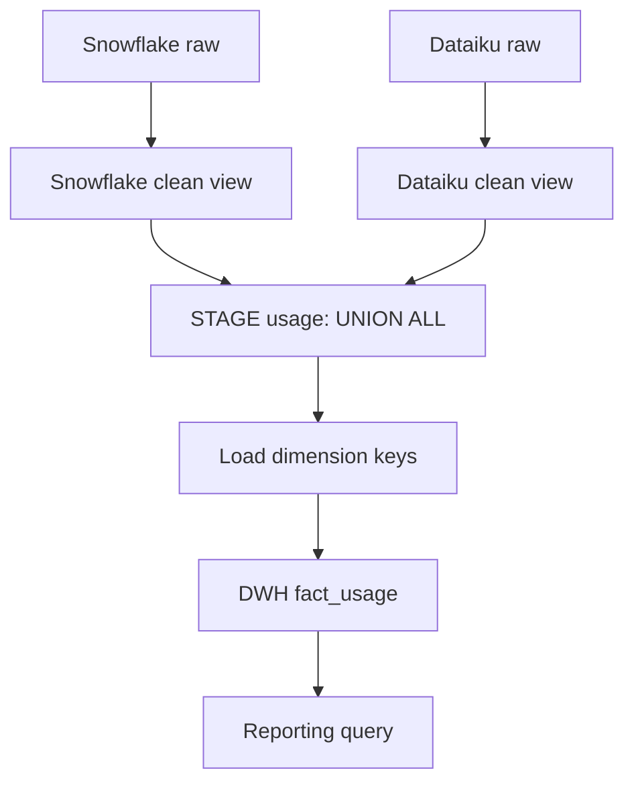

# Lab 03 — Data Warehouse & ETL

> **Your mission:** Convert two incompatible source feeds into a reliable dimensional warehouse without silently inventing missing facts.

**You will practice:** Source-to-target mapping, staging, data quality, dimensional modeling, fact grain and repeatable loads.

!!! info "Your work"

    Choose **one** route after starting the lab with `make lab-dwh` from the repository root. The workspace draft and original worksheet are separate copies; they do not automatically sync. A query runs whichever SQL you select in the workspace or enter at the terminal.

    **Route A — Guided workspace:** Run `make lab-dwh-workspace` from the repository root. Keep that terminal open and use the Codespace **Ports** tab to open private port **8767**. Write your draft and select **Run query** to execute one read-only statement. **Apply changes** commits a successful statement to the lab database; preserve your work first. Each click is one transaction, so use the terminal for multi-statement transactions and the provided repeat-load exercise. Test any unsafe insert only in an isolated disposable setup. Use **Save answers** regularly; edits are not autosaved. Use **Download SQL** to keep the draft outside the Codespace, and keep your report separately.

    **Route B — Codespace editor:** In Explorer, open `labs → 03-dwh-etl → sql → student_exercises.sql`, write your answers and save with **Ctrl+S** (Windows/Linux) or **⌘S** (Mac). Keep explanations in a separate Markdown or PDF report. The provided `01_stage.sql` and `02_dwh.sql` are lab setup scripts; do not edit them for your answers. From the repository root, open a SQL prompt:

    ```bash
    cd labs/03-dwh-etl
    docker compose exec postgres psql -U student -d dwh_etl_lab
    ```

    Copy your queries from the saved worksheet into the prompt and compare the output with the assignment. Exit with `\q`. For the repeated-load exercises, preserve your work first; test any unsafe insert only in an isolated disposable setup. Download the saved worksheet from Explorer or commit and push it to your own fork to keep a copy outside the Codespace.

    **Check for either route:** From the repository root, `make test LAB=03-dwh-etl` checks that the source and fact tables are nonempty; it does not test either answer copy. Neither this check nor the workspace grades your SQL, and saving or downloading does not submit your work.

    **Prepare your work:** Keep your completed SQL answers and a short reasoning report in Markdown or PDF, including the requested explanations and star schema. On Route A, **Download SQL** exports the draft as `lab03_student_exercises.sql`; prepare and back up the report separately. **Download results CSV**, when useful as additional evidence, includes only the displayed rows. On Route B, back up the saved worksheet and report from Explorer or your own fork.

    **Back up and submit:** Guided drafts live in `.workspace-data/`, which Git ignores; committing or pushing the original worksheet does not back up the guided draft. Download your SQL, report and any required evidence outside the Codespace. The assignment names `student_exercises.sql`; if your instructor asks for that filename, rename a copy of the downloaded SQL without overwriting your original worksheet. Back up any database changes you need before a reset or rebuild. Follow your instructor's submission method and deadline. See [troubleshooting](../troubleshooting.md).

## 1. Get ready

From the repository root in Codespaces:

```bash
make lab-dwh
```

[Open Lab 03](https://github.com/OrPerets/postgres-data-engineering-student/tree/main/labs/03-dwh-etl) · [Full assignment](https://github.com/OrPerets/postgres-data-engineering-student/blob/main/labs/03-dwh-etl/STUDENT_ASSIGNMENT.md)

### Checkpoint — Did the pipeline load?

```bash
cd labs/03-dwh-etl
docker compose exec -T postgres psql -U student -d dwh_etl_lab < sql/03_verify.sql
```

**Expected with the supplied sample:** five Snowflake observations and five Dataiku observations; ten unified staging records. These are *sample rows*, not evidence of source completeness.

## 2. Follow one record through three layers

```text
SRC (raw text)
    ↓
STAGE (typed views + quality flags)
    ↓
DWH (dimensions + fact_usage)
```

- **SRC:** Original fields and source-specific meanings.
- **STAGE:** Standardized names and types, built as views; no physical copy.
- **DWH:** Surrogate dimension keys and stored source-observation facts.

[Try the observation explorer and practice quiz](../activities/lab03-learning-pack.md) to follow sample records through the three layers. Both are browser simulations.

### Predict

What happens when an estimated cost is empty? Is it zero, missing, or invalid? Why must `source_code` be retained when comparing identities across systems?

## 3. Inspect transformations

Run queries against `STAGE_SCHEMA.snowflake_clean`, `STAGE_SCHEMA.dataiku_clean`, and `STAGE_SCHEMA.usage`.

**Checkpoint:** Explain why `UNION ALL` preserves both feeds rather than joining or deduplicating them.

**Hint:** `NULL` for cost means "unknown"; `0` means a known zero cost.

## 4. Trace a fact row

Find the sample with `batch_id='dk-sample-v1'` and `row_no=4`. Join `DWH_SCHEMA.fact_usage` to the user, source, model and entity dimensions.

**Checkpoint:** Does its missing cost stay missing? Why is a source natural key different from a DWH surrogate key?

## 5. Test the engineering behavior

Rerun `sql/02_dwh.sql` **only after preserving any assignment changes**. Compare fact counts before and after.

**Predict:** Does `ON CONFLICT DO NOTHING` prevent duplicate fixed-batch inserts? Will it propagate a correction made to a previously loaded source row?

Try the [repeated fact load explorer](../activities/lab03-learning-pack.md#explore-repeated-fact-loads) to compare the source and fact after a hypothetical correction. It is a browser simulation and does not modify the database.

### Optional hints for the assignment

Try each question first. Expand a hint for guidance without revealing a full solution.

<details><summary>Question 1 — Map source fields</summary><p>Compare source names and formats with the target views. Keep each source’s cost meaning visible.</p></details>

<details><summary>Question 2 — Typed staging</summary><p>For each source, identify a raw text field and inspect its corresponding typed output in the clean view.</p></details>

<details><summary>Question 3 — Missing and invalid</summary><p>Compare empty input and malformed populated input with the cost value and invalid-number flag. A NULL cost does not tell you the amount was zero.</p></details>

<details><summary>Question 4 — Combine feeds</summary><p>Consider whether appending both sets of rows or matching them on a shared key preserves the supplied observations.</p></details>

<details><summary>Question 5 — Quality flags</summary><p>Choose flags and trace the inputs or conditions that cause each one. Distinguish unknown information from contradictory information.</p></details>

<details><summary>Question 6 — Fact grain</summary><p>State what one row corresponds to and which source identifiers distinguish it. Avoid implying source coverage or real-world event granularity is verified.</p></details>

<details><summary>Question 7 — Star schema</summary><p>Locate the fact table and follow its foreign keys to each of the five dimensions. Label the relationships.</p></details>

<details><summary>Question 8 — Natural and surrogate keys</summary><p>Identify who supplies the natural identifier and who generates the warehouse key. Check the uniqueness scope for the natural key.</p></details>

<details><summary>Question 9 — Trace missing cost</summary><p>Identify the requested batch and row first. Join the referenced descriptive dimensions and check the value with IS NULL.</p></details>

<details><summary>Question 10 — Repeated load</summary><p>Count fact rows before and after a repeat, then read the conflict action. Ask what would happen if an existing source value changed.</p></details>

<details><summary>Question 11 — Monthly cost</summary><p>Group by source and month. Report the known-cost sum alongside a separate count of observations whose cost is unknown.</p></details>

<details><summary>Question 12 — Top users</summary><p>Aggregate by user within each source before applying a ranking. Add a stable tie-breaker without combining identities from different sources.</p></details>

<details><summary>Question 13 — Cost per 1,000 tokens</summary><p>Define the eligible records before summing. Use cost and positive token values from the same eligible records and state both totals.</p></details>

<details><summary>Question 14 — Daily reporting</summary><p>Start with the reporting scope and a calendar, then attach observed rows. Missing observations alone do not establish complete coverage or true zero usage.</p></details>

<details><summary>Question 15 — Quality audit</summary><p>Use conditional counts for missing cost, invalid numbers and inconsistent totals. Examine how unknown token consistency differs from false.</p></details>

<details><summary>Question 16 — Duplicate insertion</summary><p>Compare counts for the fixed batch before and after the supported load. Test any unsafe INSERT only in an isolated disposable setup.</p></details>

<details><summary>Question 17 — Corrections and deletes</summary><p>For each ingestion approach, ask what evidence of changed or removed rows it receives and what state or comparison it needs.</p></details>

<details><summary>Question 18 — Production improvement</summary><p>Choose a concrete improvement such as reconciliation or monitored data-quality checks and explain how it preserves missing values and source meaning.</p></details>

## Visual checkpoint — One observation across the layers



### Expected counts for the provided teaching sample

| Stage | Snowflake | Dataiku | Total |
|---|---:|---:|---:|
| Raw source rows | 5 | 5 | 10 |
| Unified staging rows | 5 | 5 | 10 |
| Fact rows after initial load | 5 | 5 | 10 |

These are expected **sample observation counts**, not proof that the real source systems are complete. On an untouched database, the seed and DWH scripts are designed to preserve one fact per sample observation.

### Investigate the missing value

Use `batch_id = 'dk-sample-v1'` and `row_no = 4`. The supplied record has missing cost and token fields.

**Checkpoint:** Query `STAGE_SCHEMA.usage` and `DWH_SCHEMA.fact_usage` for that record. Does missing cost remain `NULL` rather than becoming zero?

**Think further:** A STAGE view reflects updated source values on future reads, while a previously loaded fact does not automatically update.

## 6. Complete and reflect

Write your SQL in the guided workspace or your Codespace copy of [student_exercises.sql](https://github.com/OrPerets/postgres-data-engineering-student/blob/main/labs/03-dwh-etl/sql/student_exercises.sql), and prepare the explanations from the [assignment](https://github.com/OrPerets/postgres-data-engineering-student/blob/main/labs/03-dwh-etl/STUDENT_ASSIGNMENT.md).

Explain:
- The grain of a fact row.
- Why dimension keys are resolved before fact loading.
- Why missing source coverage cannot be interpreted as zero usage.

## Job interview questions

Try answering aloud before opening the suggested answers. Use examples from this lab to support your explanation.

<details><summary>1. What is the grain of a fact table, and why define it first?</summary><p>The grain says exactly what one fact row represents. Here it is one source observation identified by its batch and row number. Defining it first helps select dimensions, measures and uniqueness rules without mixing different levels of detail.</p></details>

<details><summary>2. Why use a staging layer between raw sources and a warehouse?</summary><p>Staging provides a place to standardize fields and types, retain source context, and expose data-quality problems before loading facts. In this lab, source-specific clean views are appended with <code>UNION ALL</code> so the observations are preserved rather than silently deduplicated.</p></details>

<details><summary>3. What is the difference between a natural key and a surrogate key?</summary><p>A natural key identifies an entity in a source system; a surrogate key is generated by the warehouse for a dimension row. Source identifiers may only be unique within their source, so the warehouse must preserve that scope when resolving dimension keys.</p></details>

<details><summary>4. Is an idempotent load enough to handle source corrections?</summary><p>No. A repeatable load that skips existing keys can prevent duplicate rows, but it will also skip corrections to already loaded records. Handling changes and deletes requires an explicit approach, such as change capture or reconciliation, and appropriate update rules.</p></details>

**Next:** [Lab 04 — MapReduce](04-mapreduce.md).
