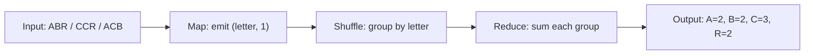

# Lab 04 — MapReduce

> **Your mission:** Transform a large task into Map → Shuffle → Reduce operations and decide when local combination is safe.

**You will practice:** Key-value mapping, grouping, reducer partitioning, combiners, mean/variance aggregation and skew.

!!! info "Your work"

    **Guided workspace:** From the repository root, run `make lab-mapreduce-workspace`. Keep the terminal open and use the Codespace **Ports** tab to open private port **8768** in a browser. Work on a separate draft of `student_tasks.py`, add task notes, run examples and the lab tests. Explicitly save and download your code and notes. The original file remains available as an alternative.

    **Edit:** In your Codespace Explorer, open `labs → 04-mapreduce → student_tasks.py` and implement the functions while preserving their signatures. The GitHub link below shows the starter; edit your own Codespace copy.

    **Run and check:** From the repository root, enter the lab folder and run the demo and tests:

    ```bash
    cd labs/04-mapreduce
    python mapreduce_demo.py
    python -m unittest tests.test_demo -v
    python -m unittest discover -s tests -v
    ```

    The demo tests check the reference implementation. The full suite also checks student functions and initially fails until you implement them; passing tests are helpful checks, not a complete grade of your report or reasoning.

    **Keep and submit:** Save `student_tasks.py`, a short report with the requested trace and explanations, passing test output, and a 200–300 word discussion. Follow the [full assignment](https://github.com/OrPerets/postgres-data-engineering-student/blob/main/labs/04-mapreduce/STUDENT_ASSIGNMENT.md) and your instructor's submission instructions.

    **Back up:** Download copies from Explorer or commit and push your work to your own GitHub fork. Saving in the editor alone does not submit or back up your work. See [environment setup](../getting-started.md) and [troubleshooting](../troubleshooting.md).

## 1. Get ready

From the repository root:

```bash
make lab-mapreduce
```

No PostgreSQL or Docker is required for this lab.

[Open student code](https://github.com/OrPerets/postgres-data-engineering-student/blob/main/labs/04-mapreduce/student_tasks.py) · [Full assignment](https://github.com/OrPerets/postgres-data-engineering-student/blob/main/labs/04-mapreduce/STUDENT_ASSIGNMENT.md)

## 2. Predict the first output

Input records:

```text
ABR
CCR
ACB
```

**Question:** How many times does each character occur? Write your prediction before running the demo.

## 3. Understand the three stages

1. **Map:** Emit `(letter, 1)` for each occurrence.
2. **Shuffle:** Group all values belonging to the same letter.
3. **Reduce:** Sum each group into one count.

```bash
cd labs/04-mapreduce
python mapreduce_demo.py
```

**Checkpoint:** The counts should be A=2, B=2, C=3, R=2. Now change the number of reducers. Does the answer change?

## 4. Build your own functions

Open `student_tasks.py`. Implement a word mapper, a WHERE-like filter mapper, mergeable mean states and mergeable population-variance states.

### Mini challenge — Why not average averages?

Suppose one worker observes `[1]` and another observes `[3,5,7]`. Compare the naive average of worker averages to the actual mean of all four values.

**Hint:** A safe mean combiner merges `(sum, count)`, not just the average.

### Practice with an interactive trace

[Open the MapReduce trace and practice quiz](../activities/lab04-learning-pack.md) to step through a small character-count example in your browser. This is a logical simulation, not a networked cluster.

### Optional assignment hints

Try the assignment yourself first; expand a hint when you need direction. These do not provide the assignment solutions.

<details><summary>1 — Trace the pipeline</summary><p>Track every character occurrence through map, group all values for the same key, then sum each group.</p></details>

<details><summary>2 — Compare reducer counts</summary><p>Predict what changes about the grouping workload and what must stay unchanged in the final count if every key is routed consistently.</p></details>

<details><summary>3 — Compare combiner on and off</summary><p>Count mapped pairs and pairs passed into shuffle separately. A local aggregate may reduce pairs but must preserve the final count.</p></details>

<details><summary>4 — Word mapping</summary><p>Split the line by whitespace and normalize case. Does every occurrence contribute a separate pair, even when a word repeats?</p></details>

<details><summary>5 — Filter mapper</summary><p>Check both status and the amount threshold against each record before emitting. Consider records that satisfy only one condition.</p></details>

<details><summary>6 — Mergeable mean</summary><p>Keep a partial sum and the number of observations together. Think about unequal split sizes and an empty input before computing the final mean.</p></details>

<details><summary>7 — Population variance</summary><p>Preserve the requested partial count, sum and sum of squares across splits. Consider the empty case and discuss cancellation when values are close together.</p></details>

<details><summary>8 — Reproducible partitioning</summary><p>Compare Python's process-dependent hash behavior with a deterministic byte-based hash. What should happen to the same key across runs?</p></details>

<details><summary>9 — Skewed key</summary><p>Imagine most input pairs have the same key. Which reducer gets that key, and what extra work might a mitigation introduce?</p></details>

<details><summary>10 — Unsafe combiners</summary><p>Ask whether a partial result can be merged repeatedly without losing information. Consider unequal group sizes and operations whose order matters.</p></details>

<details><summary>11 — Shuffle and mapper cost</summary><p>Distinguish local computation from intermediate-data movement, then compare a one-process simulation with a real networked cluster.</p></details>

## 5. Validate your work

```bash
python -m unittest tests.test_demo -v
python -m unittest discover -s tests -v
```

**Expected:** Demo tests pass. Student tests initially raise `NotImplementedError`; they should pass after you implement the functions. Do not modify tests to hide errors.

## 6. Think like a distributed engineer

Why do hot keys create skew? What communication does Shuffle represent? Which combiners are unsafe, and why?

This exercise is a **single-process logical simulator**, not a real multi-machine Hadoop deployment.

## Job interview questions

Try answering aloud before opening the suggested answers. Use examples from this lab to support your explanation.

<details><summary>1. What happens in the Map, Shuffle and Reduce stages?</summary><p>Map turns input records into intermediate key-value pairs. Shuffle routes and groups values by key. Reduce processes each key's group to produce a result, such as a count.</p></details>

<details><summary>2. When is a combiner safe, and why can averaging worker averages be wrong?</summary><p>A combiner is safe when its partial state can be merged repeatedly without changing the intended result. An unweighted average of worker means can be wrong when workers have different counts; merge <code>(sum, count)</code> instead and divide once at the end.</p></details>

<details><summary>3. What is a hot key, and how can you reduce its impact?</summary><p>A hot key receives a disproportionate share of records, so its assigned reducer can become a bottleneck. Local aggregation can reduce intermediate data when valid; another approach is to split the hot key across buckets and perform a second aggregation, at the cost of an extra step.</p></details>

<details><summary>4. Why must partitioning route identical keys consistently?</summary><p>All values for a key must reach the same reducer for a single-stage per-key result. A stable partition function makes this routing reproducible across workers and runs; changing the number of reducers may change assignments, but not correct final counts.</p></details>

**Next:** [Lab 05 — PageRank](05-pagerank.md).


## Visual walkthrough — Follow the keys



### Trace table

| Stage | Example for key C |
|---|---|
| Input | `CCR` and `ACB` contain C |
| Map | `(C,1), (C,1), (C,1)` |
| Shuffle | `C → [1, 1, 1]` |
| Reduce | `C → 3` |

**Pause and predict:** If the number of reducers changes from 1 to 3, should the final count of C change?

### Combiner investigation

Compare `shuffle_pairs` with and without a local combiner:

```bash
python mapreduce_demo.py
```

A combiner may reduce intermediate pairs but **must preserve the final result**. For mean, combine `(sum, count)` states instead of averaging partial averages.

> The arrows represent logical movement. This exercise is not a real networked shuffle across Hadoop nodes.

## Guided exercise — Map → Shuffle → Reduce by hand

**Before running the code:** Predict the output for these three input records:

```text
ABR
CCR
ACB
```

### Step 1: Map

Write one `(letter, 1)` pair for every character. Repeated letters must create repeated pairs.

| Input | Mapper output — fill in |
|---|---|
| ABR | ? |
| CCR | ? |
| ACB | ? |

### Step 2: Shuffle

Group the intermediate values by their key. Complete this table without executing Python:

| Key | Grouped values |
|---|---|
| A | ? |
| B | ? |
| C | ? |
| R | ? |

### Step 3: Reduce

For every key, sum its grouped values. Compare your prediction with the program:

```bash
cd labs/04-mapreduce
python mapreduce_demo.py
```

<details>
<summary>Reveal the expected intermediate results</summary>

| Input | Map output |
|---|---|
| ABR | (A,1), (B,1), (R,1) |
| CCR | (C,1), (C,1), (R,1) |
| ACB | (A,1), (C,1), (B,1) |

| Key | Shuffled values | Reduced result |
|---|---|---:|
| A | [1, 1] | 2 |
| B | [1, 1] | 2 |
| C | [1, 1, 1] | 3 |
| R | [1, 1] | 2 |

</details>

### Checkpoint: Number of reducers

Try 1, 2 and 3 reducers using `run_char_count` in `mapreduce_demo.py`. **Predict:** Does changing the number of reducers affect the final counts, or only the grouping workload?

<details>
<summary>Reveal the conceptual answer</summary>

All occurrences of a key must be assigned to the same reducer. Correct partitioning changes where work is performed, but not the final counts.

</details>

## Combiner investigation — Saving work safely

Run the demonstration with and without local combination. Compare `mapper_outputs` and `shuffle_pairs`.

- **A combiner is safe for sums:** `(C,1), (C,1), (C,1)` can become `(C,3)`.
- **Naively averaging worker averages is unsafe:** unequal group sizes get incorrect weights.
- **A safe distributed mean uses a mergeable state:** `(sum, count)`.

**Try this:** Worker 1 sees `[1]`; worker 2 sees `[3,5,7]`. Compute the average of the two local means, then the mean of all four numbers. Are they equal?

<details>
<summary>Reveal a hint and check your reasoning</summary>

Worker means are 1 and 5, so their unweighted mean is 3. All four observations have mean 4. Preserve `(sum, count)` instead.

</details>

## Mini challenge — Your own MapReduce input

Use three new records:

```text
DATA
DARK
TASK
```

1. Hand-calculate map outputs, shuffle groups and final counts.
2. Explain how a hot key could overload one reducer.
3. Describe when local combination reduces intermediate data and when it cannot.
4. Change the records in a **copy** of the demo and verify your answer.

## If your result is wrong

- Did you emit one pair per **character**, including duplicates?
- Did you group pairs by the emitted key?
- Did you count occurrences rather than number of input lines?
- Did your combiner preserve enough information to produce the correct final aggregate?

**Finish:** Implement the functions in `student_tasks.py` and run `python -m unittest discover -s tests -v`. Student tests initially fail until implementations are complete.

**Remember:** This tutorial simulates MapReduce on one machine; it does not measure a real network shuffle.

## Try the interactive simulator (preview)

The [Algorithm Explorers browser app](https://github.com/OrPerets/postgres-data-engineering-student/tree/main/simulators) is available for **private Codespaces testing**. From the repository root run:

```bash
python -m http.server 8000 --directory simulators
```

Open forwarded port **8000** in the Codespaces Ports panel (keep visibility **Private**). Select **MapReduce**, change the input or parameters, and navigate one step at a time. The app is not yet deployed as a public website.
