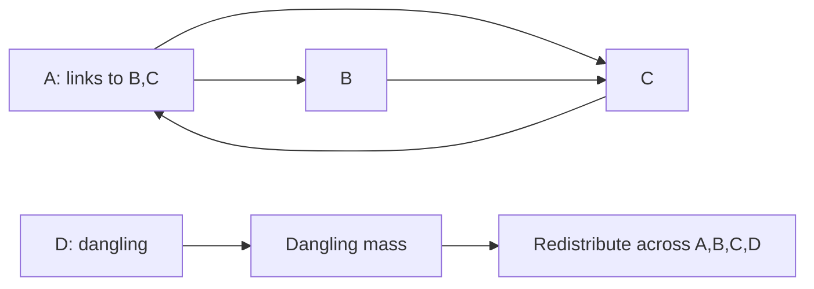

# Lab 05 — PageRank

> **Your mission:** Calculate page importance on a directed graph and observe how rank changes over repeated iterations.

**You will practice:** Rank propagation, normalization, damping, dangling nodes, convergence and MapReduce-style computation.

## 1. Get ready

From the repository root:

```bash
make lab-pagerank
```

[Student task file](https://github.com/OrPerets/postgres-data-engineering-student/blob/main/labs/05-pagerank/student_tasks.py) · [Full assignment](https://github.com/OrPerets/postgres-data-engineering-student/blob/main/labs/05-pagerank/STUDENT_ASSIGNMENT.md)

## 2. Predict rank flow

Start with:

```text
A → B, C
B → C
C → A
```

Each page initially has rank `1/3`. A splits its contribution across B and C, while B and C send their whole ranks to one destination.

**Predict:** Which page ranks highest after the first iteration?

## 3. Run the example

```bash
cd labs/05-pagerank
python pagerank_demo.py
```

**Checkpoint:** First iteration should give A=1/3, B=1/6, C=1/2 (without damping).

## 4. Add dangling nodes and damping

Add D, a page without outlinks. Use damping `d=0.85`:

```text
new_rank(p) = (1-d)/N + d*(incoming_contributions + dangling_mass/N)
```

**Predict:** Why does rank mass disappear if a dangling node is ignored?

**Checkpoint:** The four-page first iteration should approximately be A=.303125, B=.196875, C=.409375, D=.090625. The ranks must sum to 1.

## 5. Implement and validate

Complete contribution mapping, shuffle grouping, dangling mass, one damped update and convergence in `student_tasks.py`.

```bash
python -m unittest tests.test_demo -v
python -m unittest discover -s tests -v
```

Student tests intentionally fail until completed.

## 6. Performance experiment

```bash
python benchmark.py --nodes 1000 10000 --workers 2 4 --iterations 12 --trials 3
```

Record measured times, speedup and efficiency. [Read the performance assignment](https://github.com/OrPerets/postgres-data-engineering-student/blob/main/labs/05-pagerank/PERFORMANCE_ASSIGNMENT.md).

**Explain:** Why can two or four worker processes be *slower* on small graphs? How is a single Codespace different from a multi-node distributed cluster?

**Next:** [Lab 06 — TF-IDF](06-tfidf.md).


## Visual walkthrough — One rank update



### First iteration with damping 0.85

Start with four pages at 0.25 each and links A→B,C; B→C; C→A; D→none.

| Page | Incoming link contribution | New rank |
|---|---:|---:|
| A | 0.250 | 0.303125 |
| B | 0.125 | 0.196875 |
| C | 0.375 | 0.409375 |
| D | 0 | 0.090625 |
| **Total** | **0.750** | **1.000000** |

The missing 0.25 link contribution is dangling mass from D. Teleportation and damped redistribution preserve the total rank.

**Predict:** What would happen to the sum of ranks if the algorithm simply discarded D's rank?

**Try it:** Run `python pagerank_demo.py` and compare the first iteration to this table. Then implement the functions in `student_tasks.py`.

### Performance: what is and isn't measured

The optional benchmark compares sequential PageRank with multi-process mapping on **one Codespace host**. It does not benchmark a real multi-node cluster. Explain process startup, communication overhead and centralized reduction before interpreting any speedup.

## Guided exercise — Compute one PageRank iteration by hand

Start with a directed graph:

```text
A → B, C
B → C
C → A
```

Each page starts with rank `1/3`. **Do not run the demo yet.** Predict the rank after one iteration *without damping*.

### Step 1: Distribute contributions

For each page, divide its current rank equally among outgoing links:

| Page | Outlinks | Contribution to each outlink |
|---|---|---|
| A | B, C | ? |
| B | C | ? |
| C | A | ? |

### Step 2: Collect contributions

Each page's next rank is the sum of contributions received from its in-neighbors.

| Destination | Incoming contributions | New rank |
|---|---|---|
| A | ? | ? |
| B | ? | ? |
| C | ? | ? |

<details>
<summary>Reveal the first-iteration solution</summary>

A sends `1/6` to B and `1/6` to C. B sends `1/3` to C. C sends `1/3` to A.

| Page | New rank |
|---|---:|
| A | 1/3 |
| B | 1/6 |
| C | 1/2 |

The ranks still sum to `1`.

</details>

### Step 3: Verify with Python

From the repository root:

```bash
make lab-pagerank
```

Or, from `labs/05-pagerank`:

```bash
python pagerank_demo.py
```

**Checkpoint:** Can you explain why C has the highest rank after one iteration?

## Add a dangling page and damping

Now include page D with no outlinks:

```text
A → B, C
B → C
C → A
D → (none)
```

Each page starts at `0.25` and damping is `d = 0.85`.

The update is:

```text
PR_next(p) = (1-d)/N + d * (incoming(p) + dangling_mass/N)
```

**Predict:** What happens if D's rank is simply discarded? What must the total of all page ranks be?

<details>
<summary>Reveal the first damped iteration</summary>

| Page | Incoming link contribution (before damping) | New rank |
|---|---:|---:|
| A | 0.250 | 0.303125 |
| B | 0.125 | 0.196875 |
| C | 0.375 | 0.409375 |
| D | 0 | 0.090625 |
| **Total** | **0.750** | **1.000000** |

D contributes dangling mass `0.25`, redistributed uniformly and multiplied by the damping factor. Teleportation adds `(1-d)/N` to each page.

</details>

## Checkpoint — Conservation and convergence

For every iteration, verify:

1. All ranks are nonnegative.
2. Their sum is approximately 1, allowing for floating-point rounding.
3. The difference between successive iterations shrinks toward the stopping tolerance.

**Hint:** If ranks stop summing to 1, check whether dangling mass was lost or damping was applied only to link contributions.

## Connect it to MapReduce

One iteration can be understood as:


**Think:** Why must the adjacency list be preserved between iterations? Why is PageRank more expensive than a one-pass word count?

## Mini challenge — Explore the damping factor

Run the model using `d=0.50`, `0.85`, then `0.95`. Record final rank order, number of iterations and whether the total rank remains 1.

Try the [performance benchmark](https://github.com/OrPerets/postgres-data-engineering-student/blob/main/labs/05-pagerank/PERFORMANCE_ASSIGNMENT.md) and explain why more local worker processes can sometimes make performance worse.

**This benchmark uses one host, not a multi-machine Hadoop cluster.**

## If your output differs

- Are outlinks counted correctly?
- Did every page distribute `rank/out_degree`?
- Did you handle D's dangling mass?
- Was damping applied to both incoming contributions and redistributed dangling mass?
- Did your convergence check use a consistent distance measure?

**Finish:** Complete `student_tasks.py` and run `python -m unittest discover -s tests -v`.

## Try the interactive simulator (preview)

The [Algorithm Explorers browser app](https://github.com/OrPerets/postgres-data-engineering-student/tree/main/simulators) is available for **private Codespaces testing**. From the repository root run:

```bash
python -m http.server 8000 --directory simulators
```

Open forwarded port **8000** in the Codespaces Ports panel (keep visibility **Private**). Select **PageRank**, change the input or parameters, and navigate one step at a time. The app is not yet deployed as a public website.
