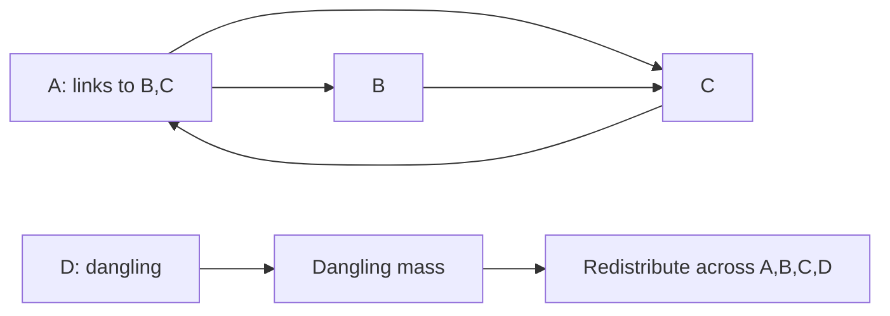
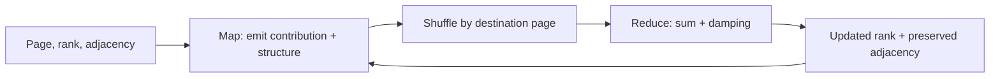

# Lab 05 — PageRank

> **Your mission:** Calculate page importance on a directed graph and observe how rank changes over repeated iterations.

**You will practice:** Rank propagation, normalization, damping, dangling nodes, convergence and MapReduce-style computation.

!!! info "Choose how to work"

    Choose **one** path below. The guided workspace uses a separate draft of `student_tasks.py`; the Codespace editor and terminal commands use the original file in the lab folder. Changes do not automatically sync between them.

    **Option A — Guided workspace**

    1. From the repository root, run `make lab-pagerank-workspace`. Keep that terminal open. In the Codespace **Ports** tab, open private port **8769** in a browser.
    2. Edit the Python draft and add task notes. Use **Run example** to explore, **Run demo tests** for the reference checks, and **Run all tests** to check the code currently in the workspace editor; the latter does not test the separate file in Explorer.
    3. Select **Save work** to save the draft in the Codespace; edits are not autosaved. Use **Download Python**, **Download notes** and the test **Download output** button to keep copies outside the Codespace. Add any remaining required report material separately. Workspace drafts live in the Git-ignored `.workspace-data/` folder, so committing and pushing a fork does not back up those drafts.

       **Download Python** produces `lab05_student_tasks.py`. The assignment names `student_tasks.py`: keep the downloaded file as a backup and, if needed for submission, rename a separate copy to `student_tasks.py` according to your instructor's instructions. Terminal tests import the lab folder's `student_tasks.py`, not the downloaded file; use **Run all tests** for the workspace draft. If you later move a downloaded copy into the lab folder for terminal testing, first back up the existing file so it is not accidentally overwritten.

    **Option B — Codespace editor**

    1. In Explorer, open `labs → 05-pagerank → student_tasks.py`. Implement the functions and save the file (**Ctrl+S** on Windows/Linux or **⌘S** on Mac).
    2. From the repository root, run `make lab-pagerank`, then enter the lab folder and run:

       ```bash
       cd labs/05-pagerank
       python -m unittest tests.test_demo -v
       python -m unittest discover -s tests -v
       ```

       The full test suite checks the `student_tasks.py` file in that folder, not the guided draft. The demo tests check the reference example.
    3. Keep any test output with your report: for example, rerun `python -m unittest discover -s tests -v > test-output.txt 2>&1` from the lab folder to capture it in a file. This replaces any existing `test-output.txt`; choose another filename or back up the old file if you need it. Download your edited `student_tasks.py`, report and evidence from Explorer, or commit and push those files to your own fork, to keep copies outside the Codespace.

    **Both paths — submission checklist:** Keep your completed `student_tasks.py` and a short report with hand calculations, screenshots or test output, convergence observations and discussion. Downloaded notes help prepare the report but may not contain every required item. Student tests initially fail until you implement the functions; passing tests provide feedback, not an official grade. Follow the [assignment](https://github.com/OrPerets/postgres-data-engineering-student/blob/main/labs/05-pagerank/STUDENT_ASSIGNMENT.md) and your instructor's submission instructions and deadline. Saving or downloading does not submit your work.

## 1. Get ready

From the repository root:

```bash
make lab-pagerank
```

[Student task file](https://github.com/OrPerets/postgres-data-engineering-student/blob/main/labs/05-pagerank/student_tasks.py) · [Full assignment](https://github.com/OrPerets/postgres-data-engineering-student/blob/main/labs/05-pagerank/STUDENT_ASSIGNMENT.md)

## 2. Predict rank flow

Start with:

```text
A → B, C
B → C
C → A
```

Each page initially has rank `1/3`. A splits its contribution across B and C, while B and C send their whole ranks to one destination.

**Predict:** Which page ranks highest after the first iteration?

## 3. Run the example

```bash
cd labs/05-pagerank
python pagerank_demo.py
```

**Checkpoint:** First iteration should give A=1/3, B=1/6, C=1/2 (without damping).

## 4. Add dangling nodes and damping

Add D, a page without outlinks. Use damping `d=0.85`:

```text
new_rank(p) = (1-d)/N + d*(incoming_contributions + dangling_mass/N)
```

**Predict:** Why does rank mass disappear if a dangling node is ignored?

**Checkpoint:** The four-page first iteration should approximately be A=.303125, B=.196875, C=.409375, D=.090625. The ranks must sum to 1.

[Try the interactive PageRank explorer and practice quiz](../activities/lab05-learning-pack.md). The examples run in your browser and do not execute a multi-machine cluster.

## 5. Implement and validate

Complete contribution mapping, shuffle grouping, dangling mass, one damped update and convergence in your Python draft or `student_tasks.py` file. In the guided workspace, use **Run demo tests** to check the reference example and **Run all tests** to check the draft. For the Codespace editor path, run these commands from `labs/05-pagerank` to check the file there:

```bash
python -m unittest tests.test_demo -v
python -m unittest discover -s tests -v
```

Student tests intentionally fail until completed.

### Optional hints for the assignment

Try each task first; expand a hint when you need a direction.

<details><summary>1 — Inlinks and outlinks</summary><p>For each node, list incoming and outgoing edges separately. Count the links in each list.</p></details>

<details><summary>2 — Two manual iterations</summary><p>Keep a separate rank vector for each iteration. Split each current rank over its outlinks before adding contributions to destinations.</p></details>

<details><summary>3 — In-degree and PageRank</summary><p>Compare equal in-degree pages whose incoming pages have different ranks or different numbers of outlinks.</p></details>

<details><summary>4 — Out-degree and contributions</summary><p>Count outgoing neighbors before emitting one destination contribution per edge. Handle a page without outlinks separately.</p></details>

<details><summary>5 — Shuffle grouping</summary><p>Use destination page as the key, gathering all contributions for that destination.</p></details>

<details><summary>6 — Dangling mass</summary><p>Sum the current ranks of all pages whose outgoing-neighbor lists are empty.</p></details>

<details><summary>7 — One damped update</summary><p>For each page, combine teleportation with damped incoming contributions and damped dangling redistribution. Include pages with no incoming contributions.</p></details>

<details><summary>8 — Convergence</summary><p>After each update, compare the old and new vectors using the sum of absolute differences. Add a maximum iteration limit.</p></details>

<details><summary>9 — Iterations and total rank</summary><p>Record the rank vector after each update and sum all page ranks before rounding for display.</p></details>

<details><summary>10 — Compare damping factors</summary><p>Hold the graph and stopping tolerance fixed. Compare both the resulting order and iteration counts, rather than assuming either must always change.</p></details>

<details><summary>11 — Preserve graph structure</summary><p>Ask what the next iteration needs to know about each page in addition to its new rank.</p></details>

<details><summary>12 — Safe combiner and dangling mass</summary><p>Consider which numeric values can be summed locally and how adjacency records pass through. How does the driver obtain a complete global dangling total before it is used?</p></details>

<details><summary>13 — Popular destination and skew</summary><p>Think about one destination receiving many contributions, then split that work into partial sums before combining them.</p></details>

<details><summary>14 — Simulation versus cluster</summary><p>Identify at least two missing distributed costs or behaviors such as network shuffle, fault recovery, or distributed storage.</p></details>

## 6. Performance experiment

```bash
python benchmark.py --nodes 1000 10000 --workers 2 4 --iterations 12 --trials 3
```

Record measured times, speedup and efficiency. [Read the performance assignment](https://github.com/OrPerets/postgres-data-engineering-student/blob/main/labs/05-pagerank/PERFORMANCE_ASSIGNMENT.md).

**Explain:** Why can two or four worker processes be *slower* on small graphs? How is a single Codespace different from a multi-node distributed cluster?

## Job interview questions

Try answering aloud before revealing each suggested answer. Use an example from the lab to support your explanation.

<details><summary>1. How does PageRank differ from simply counting incoming links?</summary><p>PageRank weights a link by the rank of its source and divides that source's contribution among its outgoing links. Two pages with the same number of incoming links can therefore have different ranks.</p></details>

<details><summary>2. What is a dangling node, and how does this lab handle it?</summary><p>A dangling node has no outgoing links. The lab sums the rank of all such nodes and redistributes that mass uniformly across every page, so it is not lost from the calculation.</p></details>

<details><summary>3. Why does PageRank use a damping factor?</summary><p>Damping combines following links with a chance of teleporting to another page. It limits the influence of link structure alone and helps the iteration converge; the precise result depends on the chosen factor and teleportation distribution.</p></details>

<details><summary>4. How would you tell when an iterative PageRank calculation can stop?</summary><p>Compare successive rank vectors with a stated distance, such as the sum of absolute differences, and stop when it falls below a tolerance or a maximum iteration count is reached. Also check that ranks remain nonnegative and sum approximately to one.</p></details>

**Next:** [Lab 06 — TF-IDF](06-tfidf.md).


## Visual walkthrough — One rank update



### First iteration with damping 0.85

Start with four pages at 0.25 each and links A→B,C; B→C; C→A; D→none.

| Page | Incoming link contribution | New rank |
|---|---:|---:|
| A | 0.250 | 0.303125 |
| B | 0.125 | 0.196875 |
| C | 0.375 | 0.409375 |
| D | 0 | 0.090625 |
| **Total** | **0.750** | **1.000000** |

The missing 0.25 link contribution is dangling mass from D. Teleportation and damped redistribution preserve the total rank.

**Predict:** What would happen to the sum of ranks if the algorithm simply discarded D's rank?

**Try it:** Run `python pagerank_demo.py` from the lab folder and compare the first iteration to this table. Then implement the functions in your chosen Python draft or `student_tasks.py` file.

### Performance: what is and isn't measured

The optional benchmark compares sequential PageRank with multi-process mapping on **one Codespace host**. It does not benchmark a real multi-node cluster. Explain process startup, communication overhead and centralized reduction before interpreting any speedup.

## Guided exercise — Compute one PageRank iteration by hand

Start with a directed graph:

```text
A → B, C
B → C
C → A
```

Each page starts with rank `1/3`. **Do not run the demo yet.** Predict the rank after one iteration *without damping*.

### Step 1: Distribute contributions

For each page, divide its current rank equally among outgoing links:

| Page | Outlinks | Contribution to each outlink |
|---|---|---|
| A | B, C | ? |
| B | C | ? |
| C | A | ? |

### Step 2: Collect contributions

Each page's next rank is the sum of contributions received from its in-neighbors.

| Destination | Incoming contributions | New rank |
|---|---|---|
| A | ? | ? |
| B | ? | ? |
| C | ? | ? |

<details>
<summary>Reveal the first-iteration solution</summary>

A sends `1/6` to B and `1/6` to C. B sends `1/3` to C. C sends `1/3` to A.

| Page | New rank |
|---|---:|
| A | 1/3 |
| B | 1/6 |
| C | 1/2 |

The ranks still sum to `1`.

</details>

### Step 3: Verify with Python

From the repository root:

```bash
make lab-pagerank
```

Or, from `labs/05-pagerank`:

```bash
python pagerank_demo.py
```

**Checkpoint:** Can you explain why C has the highest rank after one iteration?

## Add a dangling page and damping

Now include page D with no outlinks:

```text
A → B, C
B → C
C → A
D → (none)
```

Each page starts at `0.25` and damping is `d = 0.85`.

The update is:

```text
PR_next(p) = (1-d)/N + d * (incoming(p) + dangling_mass/N)
```

**Predict:** What happens if D's rank is simply discarded? What must the total of all page ranks be?

<details>
<summary>Reveal the first damped iteration</summary>

| Page | Incoming link contribution (before damping) | New rank |
|---|---:|---:|
| A | 0.250 | 0.303125 |
| B | 0.125 | 0.196875 |
| C | 0.375 | 0.409375 |
| D | 0 | 0.090625 |
| **Total** | **0.750** | **1.000000** |

D contributes dangling mass `0.25`, redistributed uniformly and multiplied by the damping factor. Teleportation adds `(1-d)/N` to each page.

</details>

## Checkpoint — Conservation and convergence

For every iteration, verify:

1. All ranks are nonnegative.
2. Their sum is approximately 1, allowing for floating-point rounding.
3. The difference between successive iterations shrinks toward the stopping tolerance.

**Hint:** If ranks stop summing to 1, check whether dangling mass was lost or damping was applied only to link contributions.

## Connect it to MapReduce

One iteration can be understood as:



**Think:** Why must the adjacency list be preserved between iterations? Why is PageRank more expensive than a one-pass word count?

## Mini challenge — Explore the damping factor

Run the model using `d=0.50`, `0.85`, then `0.95`. Record final rank order, number of iterations and whether the total rank remains 1.

Try the [performance benchmark](https://github.com/OrPerets/postgres-data-engineering-student/blob/main/labs/05-pagerank/PERFORMANCE_ASSIGNMENT.md) and explain why more local worker processes can sometimes make performance worse.

**This benchmark uses one host, not a multi-machine Hadoop cluster.**

## If your output differs

- Are outlinks counted correctly?
- Did every page distribute `rank/out_degree`?
- Did you handle D's dangling mass?
- Was damping applied to both incoming contributions and redistributed dangling mass?
- Did your convergence check use a consistent distance measure?

**Finish:** Complete your Python draft or file. Use **Run all tests** in the guided workspace, or run `python -m unittest discover -s tests -v` from the lab folder to check the Codespace editor file.

## Try the interactive simulator (preview)

The [Algorithm Explorers browser app](https://github.com/OrPerets/postgres-data-engineering-student/tree/main/simulators) is available for **private Codespaces testing**. From the repository root run:

```bash
python -m http.server 8000 --directory simulators
```

Open forwarded port **8000** in the Codespaces Ports panel (keep visibility **Private**). Select **PageRank**, change the input or parameters, and navigate one step at a time. The app is not yet deployed as a public website.
