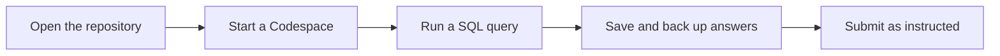
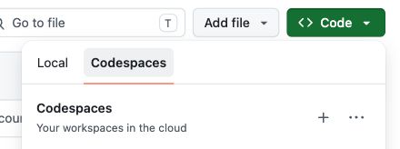

# Start here: your first SQL lab

This walkthrough takes you from the course repository to a saved SQL answer file. You will need a GitHub account and a browser. Allow extra time for the first Codespace and database startup.



## 1. Open a Codespace

1. Open the [student course repository](https://github.com/OrPerets/postgres-data-engineering-student).
2. Select the green **Code** button, then **Codespaces**.
3. Select **Create codespace on main**. If you already have a Codespace for this repository, you can reopen it or use the **+** button to create another one.
4. Wait for the editor and its terminal to finish starting. The first setup can take several minutes. If it stays on the setup screen, see [Troubleshooting](troubleshooting.md#the-codespace-is-taking-a-long-time-or-cannot-connect).
5. If the editor asks whether you trust the workspace, review the course repository and choose **Trust** when you are comfortable enabling its features.



*The menu can look different depending on your screen size, account and whether you already have a Codespace.*

## 2. Start the SQL lab

Open **Terminal → New Terminal** if the terminal is not already visible. From the repository root—the folder containing `Makefile`—run:

```bash
make lab-sql
```

Wait for the `READY: SQL lab` message. The starter launches PostgreSQL and prepares synthetic sample data. If it stops with a recovery message, preserve your work and follow [Troubleshooting](troubleshooting.md); do not repeatedly run a reset.

## 3. Run your first query

In the terminal, enter:

```bash
cd labs/01-relational-sql
docker compose exec postgres psql -U student -d query_lab
```

At the `psql` prompt, enter the following query and press Enter. The semicolon matters:

```sql
SELECT COUNT(*) FROM customers;
```

The untouched teaching sample has **15 customers**. When you have finished, exit `psql` with:

```text
\q
```

You are now back at the shell prompt. To return to the repository root, run `cd ../..`.

## 4. Write and save your answers

### Option A: Guided SQL workspace

The guided workspace presents one question at a time and runs your SQL against this Codespace's PostgreSQL database. After `make lab-sql` has finished, run this command **from the repository root**:

```bash
make lab-sql-workspace
```

Keep the terminal running. Open the **Ports** tab in the Codespace, find port **8765**, and use **Open in Browser**. Keep the forwarded port private. Enter your SQL, choose **Run query** to see results or an error, and use **Save answers** to save your drafts in the Codespace. Edits are not saved automatically. The pilot runs read-only SQL; it does not grade the answers.

The **Table structure** panel shows the current columns and keys; use **Refresh** if the database has just started.

Use **Download SQL** to download your answers as a `.sql` file and keep that copy outside the Codespace. Saved workspace drafts and the original SQL worksheet are separate; the workspace does not overwrite the worksheet. Follow your instructor's submission instructions and include any required explanations and query-plan evidence.

### Option B: SQL worksheet

1. In the editor's **Explorer**, open `labs → 01-relational-sql → sql → student_answers.sql`.
2. Write your SQL under each question and save the file (**Ctrl+S** on Windows/Linux or **⌘S** on Mac).
3. Keep a copy outside the Codespace. You can download the file from the editor's Explorer, or commit and push your work to your own GitHub fork. If you are working from a repository where you have read-only access, GitHub may prompt to create or link a fork when you commit.
4. Submit the file using the method and deadline provided by your instructor. The website does not submit the assignment for you.

Saving in the editor keeps the file in the Codespace; it does **not** by itself submit the work or back it up outside that Codespace. A Codespace can eventually be deleted after inactivity, so keep your own copy.

## 5. Check and stop

From the repository root, run:

```bash
make test LAB=01-relational-sql
```

This checks basic sample data and services. It **does not grade your SQL answers**. Use the checkpoints and the [SQL practice and quiz](activities/lab01-learning-pack.md) to review your understanding, then complete the [Lab 01 tutorial](labs/01-tutorial-practice.md).

When you are finished, stop the Codespace from [Your Codespaces](https://github.com/codespaces) to stop compute usage. Closing the browser tab alone does not necessarily stop it immediately. A stopped Codespace can still consume storage; avoid deleting it until you have backed up your work. [GitHub: stopping and starting a Codespace](https://docs.github.com/en/codespaces/developing-in-a-codespace/stopping-and-starting-a-codespace).

**Important:** Database volumes are separate from your SQL answer file. Back up anything you need before a database reset or environment rebuild; do not rely on a reset to preserve database changes.
