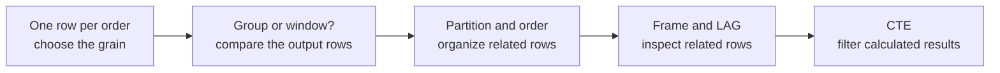
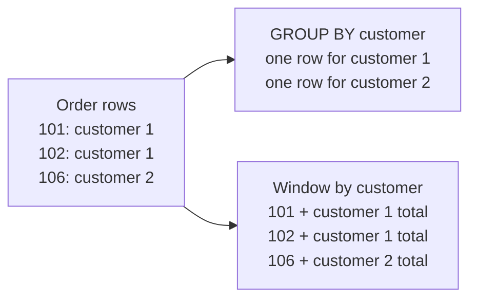
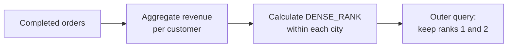

# Window functions: from rows to insight

**Core: 60–90 minutes.** Complete this guided lesson before tackling the window questions in Lab 1. You will use the same `customers`, `orders`, and `order_items` tables and the [lab's business rules](../STUDENT_BRIEF.md). Work in this order: **understand → predict → implement → validate → explain**. Write down a prediction before running each query; an incorrect prediction is useful evidence for discussion.

For another visual walkthrough, see the [course-book lesson](../../../docs/gitbook/labs/01-window-functions.md).

### The path through the lesson



The same path in words: choose the row grain, compare grouping with window calculations, define partitions and ordering, examine the rows used by each calculation, and filter results in a later query level.

## What you will learn

By the end, you should be able to:

- Choose the row grain before applying a window and explain how a window differs from `GROUP BY`.
- Identify the partition, ordering, and frame for a calculation.
- Compare `ROW_NUMBER`, `RANK`, and `DENSE_RANK` in the presence of ties.
- Use `LAG`, running totals, and moving averages with a deterministic order.
- Explain why same-date rows can have the same default-frame total, and filter window results in an outer query.

## Get started

From the repository root, start the lab with `make lab-sql`. Open [worksheet.sql](worksheet.sql), read its first section, and run it from the **lab directory**:

```bash
cd labs/01-relational-sql
docker compose exec -T postgres psql -v ON_ERROR_STOP=1 -U student -d query_lab < windows/worksheet.sql
```

The worksheet's starter queries run as supplied. Add your solutions in that file and rerun it to see your results. The worksheet creates a **temporary view for the current database session**; it disappears when the command finishes and does not change the source tables. If you copy individual queries into an interactive `psql` session, first run the view definition in that same session. SQL written in your local file persists; temporary database objects do not.

## 1. Start with the grain (10 minutes)

**Grain** answers: “What does one row represent?” An order can have multiple item lines. Applying a window directly to item lines counts and orders *lines*, not orders. For an order-level analysis, first aggregate the lines to one row per completed order. The worksheet creates `window_lab_order_revenue` for this purpose, using the lab's net-revenue formula and treating a completed order with no item lines as zero revenue. Cancelled, returned, and pending orders are excluded.

Predict before running the first worksheet queries:

1. How many rows can an order with two item lines contribute before and after aggregation?
2. Will the two views of order 101 have the same number of rows? Will their total revenue agree?
3. What should the duplicate-order check return if the order-level view has the intended grain?

**Explain:** Why can `COUNT(*) OVER (PARTITION BY customer_id)` on the item-level join give a different answer from the same expression on the order-level view?

## 2. Group versus window; partitions (10–15 minutes)

Compare the provided `GROUP BY` and `SUM(...) OVER (...)` queries. Both calculate customer revenue, but they have different output grains: `GROUP BY` collapses rows into customer groups; a window calculation adds a value to each row of its input.

The following picture uses three orders as a simplified illustration. Both approaches calculate a customer total; only the window keeps each order visible:



In this illustration the group query returns two rows and the window query returns three. The window attaches a result to each input row; it does not remove an order.

In `SUM(revenue) OVER (PARTITION BY customer_id)`, the partition is the set of the current customer's input rows. It is a logical group for the calculation, not a physical database partition. With no `PARTITION BY`, all input rows belong to one partition. A window's input is the rows remaining after `FROM`, `WHERE`, `GROUP BY`, and `HAVING` at that query level; an outer filter can act on the results afterward.

**Your turn:** add a completed-order count and each order's share of its customer's revenue to every order. Use `NULLIF` for a zero customer total. Predict how many output rows you will have, then verify that the window did not collapse them. Explain why the order for customer 12 is an important edge case.

## 3. Order, peers, and ranking (10–15 minutes)

The `ORDER BY` **inside** `OVER` defines the order or peer groups for the window; the outer `ORDER BY` controls how results are displayed. One does not replace the other. Rows tied on all window ordering expressions are *peers*.

Think of an analytical ordering as a line of rows inside each partition. A tie in the window's ordering makes a peer group; adding a unique ID breaks that peer group. An outer display order can make results easier to read, but it cannot change how a window defined its peers.

Given customer revenues `600, 600, 300` within a city, predict each ranking before running the ranking activity:

| Revenue | `ROW_NUMBER` | `RANK` | `DENSE_RANK` |
|---:|---:|---:|---:|
| 600 | ? | ? | ? |
| 600 | ? | ? | ? |
| 300 | ? | ? | ? |

Write three rankings per city using customer totals. Make `ROW_NUMBER` deterministic with `ORDER BY customer_revenue DESC, customer_id`; for `RANK` and `DENSE_RANK`, order by revenue alone so equal revenues remain peers. For a `NULL` city, PostgreSQL groups those rows in the same partition; decide whether that behavior suits the question.

**Explain:** Which ranking should you use to find the two highest *distinct revenue levels*, including ties? How is that different from selecting exactly two customers?

## 4. Looking backward with `LAG` (10–15 minutes)

For each customer's completed orders, write `LAG(revenue)` over the order sequence `order_date, order_id`. Predict the previous revenue for customer 1 before running it. The first order has no preceding row, so its result is `NULL`. The ID makes same-date ordering deterministic. Add revenue change and percentage change, using `NULLIF(previous_revenue, 0)` to avoid division by zero. A `NULL` percentage does not mean zero change.

```text
Customer 1, ordered by date and ID:
  [101]  →  [102]  →  [103]  →  [104]  →  [134]
              ↑
      LAG for this order looks one position to the left.
```

The arrow shows the sequence of existing orders. It does not add rows for days or months with no orders.

**Check:** Does filtering to customer 1 *inside* the same query affect customer 1's partition? What would happen if you filtered to only March orders before calculating `LAG`? Try filtering to March **after** calculating the window in a CTE and compare. Explain the difference.

## 5. Frames: running totals and moving averages (15–20 minutes)

A **frame** is the set of rows used by frame-sensitive calculations for the current row. A partition can contain many rows while the frame changes at each row. For customer 1, the order-level input is:

Imagine the current row is order 104. In `ROWS BETWEEN 2 PRECEDING AND CURRENT ROW`, the frame contains the current order and up to two earlier orders, while the full partition still contains all five orders:

```text
Customer 1 partition (ordered by date and ID)
┌────────────────────────────────────────────────────────┐
│  [101]   [102]   [103]   [104]   [134]                 │
│          └───────── frame ─────────┘                    │
│                           current row                  │
└────────────────────────────────────────────────────────┘
```

In words: the frame for order 104 includes orders 102, 103, and 104. Order 101 is earlier than the frame; order 134 is later than the current row. When the current row changes, the frame can move too.

| Order | Date | Revenue |
|---:|---|---:|
| 101 | 2026-01-05 | 300 |
| 102 | 2026-02-05 | 200 |
| 103 | 2026-02-05 | 200 |
| 104 | 2026-03-01 | 400 |
| 134 | 2026-03-27 | 120 |

For each order, write predictions for all three columns before adding your query:

| Order | Running sum: `ROWS` by date and ID | Running sum: default frame by date | Average of current and up to two preceding orders |
|---:|---:|---:|---:|
| 101 | ? | ? | ? |
| 102 | ? | ? | ? |
| 103 | ? | ? | ? |
| 104 | ? | ? | ? |
| 134 | ? | ? | ? |

Use `ROWS BETWEEN UNBOUNDED PRECEDING AND CURRENT ROW` with `ORDER BY order_date, order_id` for the first calculation. For the second, specify only `ORDER BY order_date` and leave out the frame. PostgreSQL's default ordered frame extends from the start of the partition through the current row's **last peer**, so both same-date orders are included together. For the third calculation, use `ROWS BETWEEN 2 PRECEDING AND CURRENT ROW` with the deterministic date-and-ID order. The first two frames contain fewer than three orders.

Notice that the two running totals deliberately differ in **both** their ordering keys and their frame specification. Adding `order_id` to the date-only window removes the same-date peer tie. Explain the separate role of each choice. A three-*order* moving average is not necessarily a three-*month* moving average.

**Isolate the choices:** First compare the default frame with explicit `ROWS UNBOUNDED PRECEDING` using `ORDER BY order_date, order_id` for both. Predict whether their totals differ. Then compare those same two frames with `ORDER BY order_date` for both. What happens to the two February orders? With date-only `ROWS`, either tied order may come first, so do not rely on which order receives the earlier total. Repeat the query and explain why a stable tie-breaker is needed for reproducible per-order results; repeated identical results do not prove the ordering is guaranteed.

## 6. Filter after calculating a window (10 minutes)

Using a CTE, calculate revenue for customers with at least one completed order and a `DENSE_RANK` per city. In an outer query, keep the two highest **distinct revenue levels**, including ties. State the output grain and explain why the ranking belongs in the inner query and its filter in the outer query. Validate that no qualifying tied customer disappears.



The ranking sees the customer totals before the outer query filters them. A `WHERE` at the ranking query's own level filters its input instead of filtering the calculated rank.

Return to Lab 1 questions 8, 9, 14, and 15, and use this sequence to reason about their requirements. Question 11 adds missing months; `LAG` alone does not generate absent rows.

## Optional: deepen your understanding

- **`LAST_VALUE` and frames:** Order by `order_date, order_id` and compare `LAST_VALUE(revenue)` with the default ordered frame and with `ROWS BETWEEN UNBOUNDED PRECEDING AND UNBOUNDED FOLLOWING`. Predict why the results differ.
- **A missing month:** For a customer with no February completed order, compare “previous order” with “previous calendar month.” Design the calendar rows needed before using `LAG` for the latter.
- **Challenge:** Find the first order at which each customer reaches 500 in cumulative completed-order revenue. Include a customer who reaches it exactly, and exclude customers who never do. Use separate query levels for cumulative calculation and selecting the first crossing.
- **Performance:** Try the optional [running-total benchmark](../benchmarks/README.md) after understanding the calculations. Measure and compare equivalent outputs; its example does not prove that windows are always faster.

## What to submit

Submit your completed worksheet and a brief explanation of: (1) row grain and `GROUP BY` versus a window, (2) ties and ranking choice, (3) the same-date frame example, and (4) why filtering before and after `LAG` can differ. Include your predictions and at least one result check. Do not edit the source tables.
